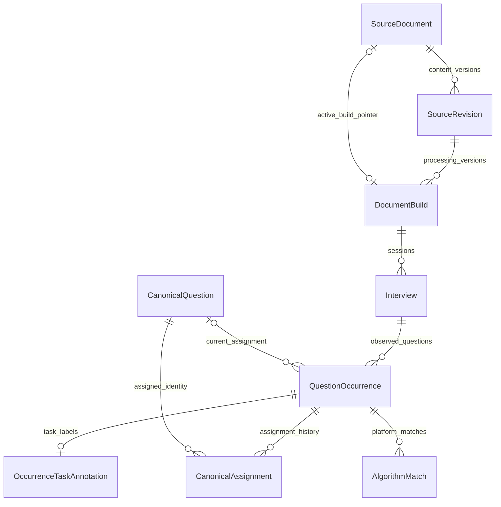

# 事实数据模型

[返回知识库入口](../README.md)

本页描述工作区代码中的来源、题目、发布版本与处理记录，不代表任何部署实例的实时状态。
关系型数据库保存结构化事实和来源引用；原始字节快照保存在文件系统；Elasticsearch 保存可重建的检索投影。
代码以 PostgreSQL 为部署存储并支持 SQLite 本地测试；具体连接配置不在本页核验范围内。
完整写入顺序见 [导入与发布流程](ingestion-flow.md)。

## 核心实体与身份

实体定义统一见 [domain/models.py](../../src/interview_intelligence/domain/models.py)。下表中的名称是可搜索的类名。

| 实体 | 一条记录表示什么 | 关键约束或引用 |
| --- | --- | --- |
| `SourceDocument` | 一个稳定来源 | `source_identity` 唯一，`aliases` 保存其他路径，`active_build_id` 指向当前构建 |
| `SourceRevision` | 该来源的一版原始内容 | `(source_document_id, raw_file_hash)` 唯一，保存快照路径和解码后文本哈希 |
| `DocumentBuild` | 某内容版本按某套处理配置生成的结果 | `(source_revision_id, processing_fingerprint)` 唯一，处理、纳入和发布状态分开 |
| `Interview` | 一篇构建中的一场面试 | `(build_id, session_key)` 唯一；保存公司、岗位、轮次、日期及其证据 |
| `QuestionOccurrence` | 面试中一次真实提问 | `(interview_id, question_order)` 唯一；保存原问法、规范问法、分类和来源 spans |
| `CanonicalQuestion` | 归并后的稳定题目身份 | 保存标准问法、展示分类、生命周期和可选重定向 |
| `CanonicalAssignment` | 某次提问归到某标准题的决定 | 候选、判定证据、judge 版本、有效 revision 区间；每次提问至多一个未关闭 assignment |
| `QuestionRelation` | 两次提问或两道标准题之间的关系 | 关系类型决定端点类型，数据库约束禁止混用 |
| `AlgorithmMatch` | 一次提问与算法平台题的匹配结果 | 保存平台、题号、匹配依据和置信度，不是标准题身份 |
| `OccurrenceTaskAnnotation` | 一次提问的任务形式标签 | 以 occurrence 为主键，保存回答形式、编码重点、审核状态及证据 |

图中的 `active_build_pointer` 表示当前业务关系；实际外键方向是 `SourceDocument.active_build_id → DocumentBuild.id`。
`QuestionOccurrence.canonical_question_id` 可空，读取和维护代码不能仅凭这个字段忽略有效来源范围。

## 三种内容版本不能混用

1. `SourceRevision` 回答“输入内容是否变化”，由原始字节哈希区分。
2. `DocumentBuild` 回答“同一输入是否换了处理规则”，由处理指纹区分。
3. `CorpusRevision` 回答“整个事实库此刻发布了哪些构建”，由发布操作递增。

来源身份由 [source_identity](../../src/interview_intelligence/ingestion/identity.py) 解析明确链接，缺少链接时使用相对路径身份。
路径、来源身份、内容哈希、数据库 UUID 各有职责，不能互相充当全部场景的主键。
相同来源出现在其他路径时可登记为别名；相同内容配不同处理指纹仍可产生新构建。

## 来源证据契约

`QuestionOccurrence.raw_question` 是可回到来源的逐字问法，`normalized_question` 是处理后的问法，`canonical_text` 是归并身份的展示问法。
后两者不能代替原始证据。`source_spans` 引用 `SourceRevision`，不是当前可变文件路径。

[SourceSpan](../../src/interview_intelligence/contracts/__init__.py) 保存 `revision_id`、字符区间、行区间、`quote` 和来源类型。
`SourceSpan.matches` 校验 quote 与字符切片、行号同时匹配；[validate_extraction](../../src/interview_intelligence/extraction/validation.py) 还校验当前 revision、taxonomy、问题及追问引用。
[decode_source / save_snapshot](../../src/interview_intelligence/ingestion/snapshot.py) 保存原始字节，统一解码后的 BOM 和换行处理。
因此字符位置基于规范解码文本，不是原始 UTF-8 字节偏移。

关系也区分事实与推断：

| `relation_type` | 端点 | 含义 |
| --- | --- | --- |
| `OBSERVED_FOLLOWUP` | occurrence → occurrence | 来源中观察到的追问，保留面试和证据 spans |
| `RELATED` / `SIMILAR` | canonical → canonical | 标准题之间的关系；默认导入归并路径会写 `RELATED` |

存在 `SIMILAR` 数据类型约束，不等于每条生产入口都会生成该关系。

## 当前有效事实与展示分类

[active_occurrences](../../src/interview_intelligence/repository/corpus.py) 的核心条件必须同时成立：

- `SourceDocument.active_build_id == DocumentBuild.id`。
- `DocumentBuild.decision == "INCLUDED"`。
- `Interview.analytics_eligible == True`。

旧构建保留用于追溯，不能把数据库内所有 occurrence 当作当前题库。
同一个 canonical 的多次出现也不能当成多道标准题；篇数、场数、提问次数和标准题数属于不同计数维度。
[refresh_canonical_classifications](../../src/interview_intelligence/repository/corpus.py) 根据当前有效 occurrence 的联合分类投票更新 canonical 展示分类。
平票时优先保留现有联合分类，否则按排序选取；这一操作不改变 canonical ID。
任务形式标签由 `OccurrenceTaskAnnotation` 独立保存，不能仅凭旧 `question_type` 推断已核验的任务标签。

## 发布状态与事务边界

`DocumentBuild` 的三个状态字段描述不同维度：

| 字段 | 默认导入路径中的语义 |
| --- | --- |
| `processing_state` | 构建写为 `READY` 后才可进入 `publish_build`；schema 默认的 `STAGING` 不是独立调度器 |
| `decision` | `INCLUDED` 纳入、`EXCLUDED` 排除、`NEEDS_REVIEW` 暂不发布 |
| `publication_state` | 当前构建为 `ACTIVE`，被替换构建为 `SUPERSEDED`，未发布默认 `UNPUBLISHED` |

[publish_build](../../src/interview_intelligence/repository/corpus.py) 在调用方事务中锁来源和 `CorpusState`，切 active build、刷新分类、递增 revision，并写发布快照及索引任务。
这些数据库变化一起提交或回滚；`EXCLUDED` 构建也可发布，用于撤下该来源旧的有效提问。
`NEEDS_REVIEW` 构建由导入服务保留而不切换旧 active build。

| 记录 | 职责 |
| --- | --- |
| `CorpusState.current_revision` | 当前数据库事实发布版本 |
| `CorpusState.indexed_revision` | 最近完成索引发布的版本 |
| `CorpusRevision.activation_manifest` | 来源身份到 active build 的发布清单 |
| `CorpusRevision.canonical_snapshot` | 该次发布保存的 canonical 展示和生命周期字段 |
| `IndexSyncTask` | 记录某 corpus revision 的索引同步需求及完成状态 |

`canonical_revision`、`task_annotation_revision` 是独立字段，不能与 corpus revision 互换；字段存在本身不证明所有相关维护流程均已实现。
Elasticsearch alias 切换与数据库提交是两个系统的步骤，不构成同一个原子事务，详见 [导入与发布流程](ingestion-flow.md)。

## 处理记录与当前限制

`PipelineRun` 目前同时承载批次运行和单文档运行；`PipelineTask` 关联单文档 run，`StageArtifact` 关联可复用抽取产物。
`EmbeddingCache` 按文本哈希和 embedding 版本复用向量；它与 ES 索引都不能充当来源事实。
`ModelCall` 保存模型调用遥测，但默认 worker 的调用记录归到批次 run，未形成完整的批次 → 文档任务 → 调用外键链。
当前批次和文档 run 主要靠 `config_snapshot.paths` 区分；不要把它们误画成已有 `parent_run_id` 的实体关系。
`PipelineTask.lease_expires_at / next_retry_at` 是 schema 字段；当前 worker 不据此实现逐任务租约和定时调度。
`IndexSyncTask` 当前由重建流程标记成功，不应描述为已有独立消费者的消息队列。

## 查询和用户状态

| 记录 | 职责 | 边界 |
| --- | --- | --- |
| `AgentConversation` / `AgentTurn` | 会话状态、版本及一次查询的持久身份与结果 | conversation version 与 corpus revision 不同 |
| `ToolInvocation` / `AgentEvent` | 工具意图、动作幂等键、回执和顺序事件 | 工具完成检查点与整轮完成分别保存 |
| `UserQuestionState` / `ReviewEvent` | 某用户对某题的掌握状态和复习历史 | 检索返回不会自动成为复习事件 |
| `UserPreference` / `UserRevision` | 用户偏好、启用的查询纠正及用户状态版本 | 纠正原反馈文件与 PG 启用状态分别保存 |
| `QuestionUsageRun` / `QuestionUsageEvent` | 候选、核验、返回、浏览等观测 | evaluation 用途不计入个人使用汇总 |
| `TenantAccount` / `TenantSession` / `TenantAdmission` | 账号、登录会话、请求准入与提供方选择 | 定义在独立模型文件；共享题库不按账号复制 |

账号实体见 [tenant_models.py](../../src/interview_intelligence/tenant_models.py)，访问控制与审计实体见 [access_models.py](../../src/interview_intelligence/access_models.py)。
原反馈位于文件系统，启用后的纠正由 [FeedbackMemory](../../src/interview_intelligence/agent/feedback_memory.py) 保存到用户偏好；不要把会话、复习、使用和纠正合写成一种记忆。

`PipelineRun` 是导入处理记录；`AgentTurn` 是查询持久记录；`agent/query_service.py::QueryRun` 是进程内执行对象。
三者都可能被简称 run，排查时必须先确定类型。查询与用户状态的执行、签名游标及恢复细节见 [查询数据流](query-flow.md)。

## 入口符号与守护测试

| 修改范围 | 先读符号 | 对应测试 |
| --- | --- | --- |
| 表关系与约束 | `Base`、上述实体 | [test_schema_constraints.py](../../tests/integration/test_schema_constraints.py) |
| 原文与构建生命周期 | `IngestService.ingest_file` | [test_ingestion_lifecycle.py](../../tests/integration/test_ingestion_lifecycle.py) |
| 发布快照与幂等 | `publish_build`、`manifest_at` | [test_corpus_snapshots.py](../../tests/integration/test_corpus_snapshots.py) |
| 当前分类投票与回滚 | `refresh_canonical_classifications` | [test_canonical_metadata_publication.py](../../tests/integration/test_canonical_metadata_publication.py) |
| 归并与证据 | `DedupService.resolve` | [test_canonicalization.py](../../tests/integration/test_canonicalization.py) |

本页由静态源码和测试定义核验；未运行测试、读取实际数据库或确认线上数据量。
