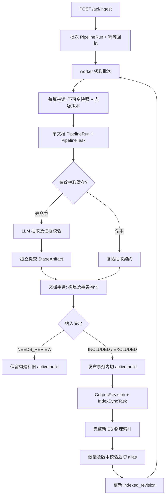

# 导入与发布流程

[返回知识库入口](../README.md)

本页描述工作区默认 API / worker 导入路径，说明输入如何成为可查询事实，以及失败后保留什么。
配置类默认值、可选 provider 能力和部署实际启用配置必须分开；本页未读取环境密钥或核验线上进程。
实体及有效事实口径见 [事实数据模型](data-model.md)。

## 主链与职责

图中 `BUILD`、`PUBLISH`、`REV` 同属一次文档数据库事务，不是三个独立提交。
`READY → WORKER` 表示返回批次循环；排除来源也可成功发布，以撤下旧事实。

| 入口 / 符号 | 职责 | 源码 |
| --- | --- | --- |
| `POST /api/ingest` | 验路径、请求幂等、创建 `QUEUED` 批次 | [api.py](../../src/interview_intelligence/api.py) |
| `main` / `_work_loop` | PostgreSQL 单 worker 锁、重启恢复、轮询批次 | [worker.py](../../src/interview_intelligence/worker.py) |
| `build_worker_services` | 按配置装配 extractor、encoder、judge、预算及模型调用 gate | [worker.py](../../src/interview_intelligence/worker.py) |
| `process_queued_run` | 遍历路径、持久进度、处理失败及同步索引 | [worker.py](../../src/interview_intelligence/worker.py) |
| `IngestService.ingest_file` | 单篇快照、缓存、抽取、物化及发布 | [pipeline.py](../../src/interview_intelligence/ingestion/pipeline.py) |
| `publish_build` | 切换当前事实、保存发布版本 | [corpus.py](../../src/interview_intelligence/repository/corpus.py) |
| `rebuild_index` | 构建完整检索投影并切换 alias | [elasticsearch.py](../../src/interview_intelligence/search/elasticsearch.py) |

## 输入身份、重复处理与缓存

[resolve_corpus_document](../../src/interview_intelligence/config.py) 解析受限语料路径；导入读取原始字节后调用 `decode_source` 和 `save_snapshot`。
[source_identity](../../src/interview_intelligence/ingestion/identity.py) 生成来源身份；同一来源的其他路径进入 aliases。
`SourceRevision` 按原始字节哈希复用；`DocumentBuild` 按源版本和处理指纹复用。
若同一构建已经是 active build，单文档任务返回 `SKIPPED`，不重新抽取或重复发布。

[extraction_config_hash](../../src/interview_intelligence/ingestion/extraction_cache.py) 包含 extractor 类型和版本、模型、prompt hash、有效请求配置、输出 schema 和 taxonomy。
文档处理指纹还加入归并 encoder / judge 版本等信息；因此改变归并配置可重建文档而复用已验证抽取。
缓存加载会复验产物 hash 和抽取契约，不能仅因文件存在便认定可复用。
缓存文件通过临时文件替换落盘，`StageArtifact` 在文档事务开始前独立提交。
这保证后续归并或发布失败时，成功的抽取结果仍可用于重试。

## 抽取与事实物化

[OpenAICompatibleExtractor.extract](../../src/interview_intelligence/extraction/provider.py) 调用模型、解析结构化草稿、校验逐字引用，并进行有限重试。
[validate_extraction](../../src/interview_intelligence/extraction/validation.py) 校验 schema、当前 revision、taxonomy、原始问法和来源 spans、问题 ID 及追问引用。
导入服务与缓存加载复用该契约，不把模型自述的“正确”作为发布依据。

| `document_kind` | 默认导入决定 |
| --- | --- |
| `INTERVIEW_REPORT` | 纳入；缺少有效面试问题视为失败 |
| `MIXED` | 有有效问题时纳入；没有时保留为 `NEEDS_REVIEW` |
| `COMPILATION` / `TUTORIAL` / `OTHER` | `EXCLUDED`，可发布排除决定 |
| `UNKNOWN` | `NEEDS_REVIEW`，不替换原 active build |

`IngestService._materialize` 只为纳入构建创建面试和有效提问，归一化元数据，再为每题解析 canonical。
模型标签、算法匹配、归并 assignment 和来源追问均在该文档事务中写入。
默认归并模型调用也发生在此事务中，因此事务时长会受到外部模型延迟影响。

## 默认归并与可选能力

[DedupService.resolve](../../src/interview_intelligence/dedup/service.py) 先取 embedding 候选，再调用 judge 输出 `SAME / RELATED / DIFFERENT`。
恰有一个 `SAME` 时复用 canonical；否则创建新 canonical；`RELATED` 另写关系。
[ElasticsearchCandidateHead](../../src/interview_intelligence/dedup/candidates.py) 可使用固定 ES 物理索引候选，加上事务内尚未索引的精确增量，最后统一精确排序。
是否走该路径由 candidate backend 和规模阈值控制，不应把可选 ANN 当作所有导入的固定步骤。

默认 worker 构造 judge 时未传 `prompt_path`；[DEFAULT_JUDGE_PROMPT](../../src/interview_intelligence/dedup/provider.py) 当前指向 `dedup_judge_v1.md`。
provider 还实现 v2 / v3 配置，其中 v3 支持来源证据；[compile_source_evidence](../../src/interview_intelligence/dedup/context.py) 提供证据上下文编译。
这些能力可由其他调用方显式选择；[eval/collect.py](../../eval/collect.py) 包含来源证据收集路径。
默认 `IngestService → DedupService.resolve → judge` 仍只传规范题文本，不传 incoming / candidate source evidence。
因此应将 v3 来源证据能力标记为可选、评测可用，不能根据文件存在宣称默认导入已启用。

## 发布与索引一致性

`publish_build` 锁定来源和 `CorpusState`，切换 active build，并把旧构建标记 `SUPERSEDED`。
同一数据库事务刷新 canonical 展示分类、递增 corpus revision、写完整发布快照和 `IndexSyncTask`。
重复发布已激活构建不递增 revision；事务失败时旧 active build 和分类一起保留。

`process_queued_run` 在每个单文档 `SUCCEEDED` 后调用索引重建，下一篇处理前即可完成前一篇的检索发布。
这是当前即时可见性的明确取舍，受 `test_published_document_is_searchable_before_processing_next_document` 约束。
重建读取当前有效事实，创建新物理索引，写入文档并校验数量，然后检查 corpus revision 未变化。
随后通过 ES `_aliases` 原子切换，再更新数据库 `indexed_revision`，并将不晚于该版本的索引任务标为成功。
数据库发布与 ES alias 切换不是跨系统原子事务；重建时发生版本变化会报告 `SNAPSHOT_CHANGED`。
查询入口要求非空 corpus 且 `current_revision == indexed_revision`，否则报 `INDEX_NOT_READY`；不能把已提交事实等同于已完成检索发布。

## 失败、重试与运行状态

| 边界 | 已提交内容和恢复行为 |
| --- | --- |
| 抽取或验证失败 | 记录单文档失败；没有通过校验的结果不会作为有效抽取缓存发布 |
| 归并或文档发布失败 | 文档事务回滚，旧 active build 保留；已独立提交的有效抽取缓存可复用 |
| 需要复核 | 单文档 task 可为 `SUCCEEDED`，run 为 `NEEDS_REVIEW`；任务成功不代表新事实已发布 |
| 索引失败 | 事实可能已经提交；批次记录 `index_error`，可走 reindex 重试 |
| 模型状态码 400/401/403/404/429 或预算耗尽 | 当前 worker 停止后续路径，把未完成路径保留用于定向重试 |
| worker 重启 | 持锁后重排 RUNNING 批次；未完成单文档 run 标失败，由批次恢复路径重新处理 |

批次通过 `finished_paths / failed_paths` 持久化进度，终态可为 `SUCCEEDED / FAILED / PARTIAL_FAILURE / NEEDS_REVIEW`。
`PipelineTask` 的租约和下次重试字段尚未驱动独立调度器；PostgreSQL advisory lock 是当前普通 worker 串行运行机制。
`IndexSyncTask` 当前由重建流程更新完成状态，未实现独立逐条拉取的索引 worker。

## 已知边界与优先跟进

每文档发布保存完整 manifest / canonical snapshot，且索引全量重建；语料增长后应评估成本，同时保留即时可见性的产品要求。
多个候选判 `SAME` 时，`DedupResolution.needs_review` 会设为真，但当前物化调用方未消费该标记；不要据此描述为完整归并审核流程。
最值得先跟进的是运行版本和调用可观测性：API 入队时 `extractor_version` 固定写 `extract_question_v2`，worker 实际按 `Settings.extraction_prompt_version` 装配。
同时批次和单文档共用 `PipelineRun`，没有显式父子外键；默认模型遥测归批次，而 task 归单文档 run。
排查实际执行版本时应联合看 worker 装配、单文档 run / build 配置和模型调用记录，不应只读批次版本字段。
后续可显式区分 run 类型、关联父子任务并记录实际执行配置；这是建议，不是本页已实现能力。

## 守护测试

| 需要确认的契约 | 测试入口 |
| --- | --- |
| 重复导入、来源别名、校验失败不发布、保留旧构建 | [test_ingestion_lifecycle.py](../../tests/integration/test_ingestion_lifecycle.py) |
| 下游失败复用缓存、配置失效、损坏缓存修复 | [test_extraction_stage_cache.py](../../tests/integration/test_extraction_stage_cache.py) |
| 批次恢复、停止条件、每文档检索可见性 | [test_worker.py](../../tests/integration/test_worker.py) |
| 发布幂等与 snapshot、分类回滚 | [test_corpus_snapshots.py](../../tests/integration/test_corpus_snapshots.py)、[test_canonical_metadata_publication.py](../../tests/integration/test_canonical_metadata_publication.py) |
| 语义归并与批量候选集合校验 | [test_canonicalization.py](../../tests/integration/test_canonicalization.py) |
| ES 重建及检索链路 | [test_elasticsearch_live.py](../../tests/integration/test_elasticsearch_live.py) |

本次仅核验源码和测试定义，未启动模型、服务或测试；测试链接不表示当前环境已通过这些检查。
