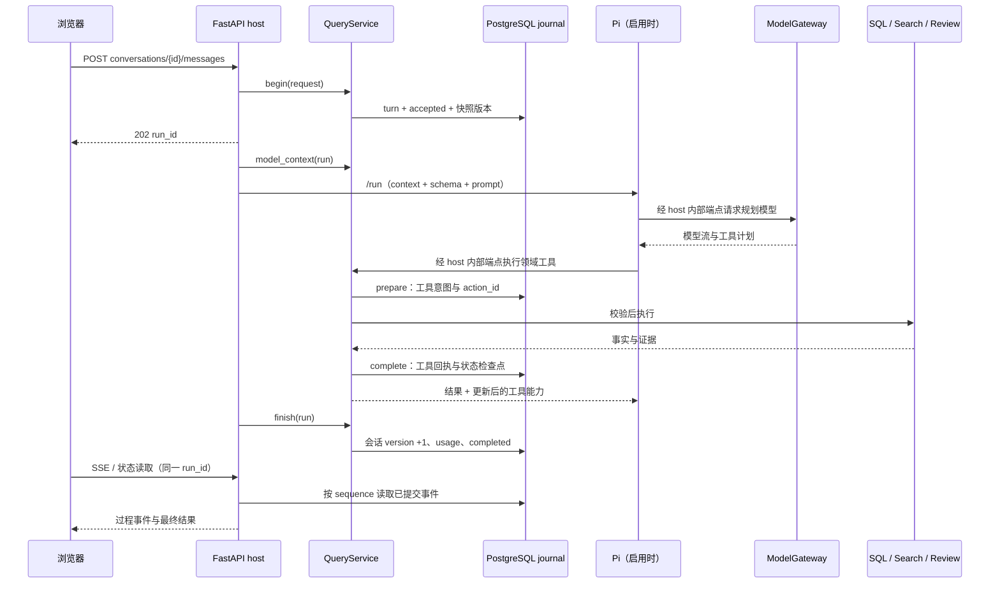

# 查询数据流与状态契约

本页描述 QueryService 主链；启动模式与 legacy 分支见 [系统架构](system.md)。
一次查询的最终事实由 host 工具与已提交回执决定，模型输出是待校验的计划或参考回答。
返回 [知识库入口](../README.md)。

## 从用户消息到最终回执

图展示启用 Pi 的自然语言主链；Pi 的多个工具步骤仍受单轮预算控制。
`execute_query` 也可采用 Jev/注入 planner，或经 `ModelGateway.plan` 直接生成 JSON；这些分支共用 host 执行器。
结构化 `POST /api/questions/list` 生成 `StructuredQueryRequest`，直接执行 LIST 并保存同类回执。

入口符号：[app.js::agentQuery](../../src/interview_intelligence/web/assets/app.js)、
[api.py::conversation_message / execute_query](../../src/interview_intelligence/api.py)、
[QueryService.begin / execute / finish](../../src/interview_intelligence/agent/query_service.py)。

## 工具与事实范围

| action | 执行与完整性边界 |
| --- | --- |
| LIST / NEXT / STATS | `list_questions` 在完整 SQL 匹配范围聚合、排名和分页；NEXT 使用已保存请求及签名 cursor |
| COUNT | `count_questions` 计算完整当前范围，返回去重题数、提问记录数等；不能用 `top_n` 限定 |
| SEARCH | SQL 资格范围内的候选召回和语义核验；最多展示 50，不提供全库 Top N 承诺 |
| DETAILS / REVIEW_STATE | 读取当前页指定题目；复习状态另支持有界 full_scope，最多 1000 题 |
| ANSWER | 模型参考回答；引用只可来自当前页，CORPUS/MIXED 需题目或本轮聚合证据 |
| RECORD_REVIEW | 当前请求明确授权、当前页范围、幂等批次写入；必须终结该轮 |
| CLARIFY | 保存澄清问题与选项，终结该轮，等待下一条用户消息 |

结构校验入口是 [query_contract.py::QuerySpec / validate_model_plan](../../src/interview_intelligence/agent/query_contract.py)。
权限最终由 [harness.py::ToolPolicy.require](../../src/interview_intelligence/agent/harness.py) 和 host 检查执行，不能靠模型声明获得。
自然语言 COUNT/LIST/STATS 可消耗规划模型调用；执行 SQL 工具本身不等于整轮无需模型。

默认提示词把精确类别榜单交给 LIST，按主题、公司或轮次看分布交给 STATS；单一大类的内部知识点分布使用 `topic_level=L2`。
“工程系统设计题，类似设计排行榜”按宽类别 SEARCH，例子不是每题的必需对象；“只要排行榜”保留窄范围，“排行榜如何设计”则生成 ANSWER。
`coding_focus=ENGINEERING` 表示工程编程任务，不能代替系统设计类别；题型偏好可以参与软召回，用户显式筛选仍须保留。
这些是 [默认规划提示词](../../prompts/query_agent_v13.md) 的行为约定，实际计划还要经过 host 校验，不等于每个模型请求都已正确执行。

技术解释、概念比较和解题可直接 ANSWER；“第二题怎么回答”先读取当前页的对应 DETAILS，再生成参考解答。
根据题库制定复习建议时，先以 `final=false` 读取所需 COUNT/STATS/LIST 等事实，再用 ANSWER 终结。
ANSWER 不向题库新增题目或标准答案，最多引用当前页 10 题，host 重新读取并验证范围。
`CORPUS/MIXED` 必须有有效题目引用或本轮聚合证据，历史 COUNT 回执不能冒充本轮证据；没有题库依据的解释标为 `GENERAL_KNOWLEDGE`。
题干来源只能证明题目出处，不能证明生成解答正确。约束与对应测试见 [QuerySpec](../../src/interview_intelligence/agent/query_contract.py)、[回答集成测试](../../tests/integration/test_intent_answers.py)。

## SEARCH 与 SQL 全集的区别

1. `search/service.py::eligible_canonical_ids` 从当前 SQL 事实计算匹配 ID，超过 50,000 拒绝。
2. `ElasticsearchRetriever.retrieve` 对该 ID 集合执行 BM25、DENSE 或 HYBRID；混合召回用 RRF。
3. 混合候选池最多 50；可选 lexical facets 与题型偏好影响候选构成，不扩大 SQL 资格范围。
4. HYBRID_RERANK 调用 reranker，使用候选原文上下文、相关性和范围核验；模型调用不经过 Pi 网关。
5. `search_questions` 再校验返回 ID，调用 SQL `get_question_detail` 回填题文、真实频次与来源。
6. QueryService 按 requested/executed pipeline、核验完整性和 invalid candidate 结果决定能否成功。

请求 HYBRID_RERANK 而核验不可用时，QueryService 不把未核验候选作为成功结果保存。
SQL eligibility 已证明空集时，不调用检索或模型，返回可重放的成功空结果并记录 `verification_basis=empty_sql_scope`；这不代表执行过模型核验。存在 eligible 题目但核验失败时仍拒绝成功。
结构异常候选可以被剔除后返回经核验的部分结果，同时标记不完整；不得把“部分”写成“完整”。
具体约束见 [query_service.py::_execute / finish](../../src/interview_intelligence/agent/query_service.py)、
[elasticsearch.py::retrieve](../../src/interview_intelligence/search/elasticsearch.py)、[reranker.py::LLMReranker](../../src/interview_intelligence/search/reranker.py)。

SEARCH 的 `frequency` 先核验最多 50 个候选，再按候选在当前 SQL 范围内的 occurrence_count 排序。
它表达“本次候选中的高频”，不表达“全库最高频”；后者应使用完整范围 SQL LIST/STATS。
`semantic_task=ALGORITHM_PROBLEM` 是 SQL 中已完成证据审计的算法集合，可分页超过 50。
该集合审计不完整时拒绝提供完整列表；它不等同于旧 `question_type` 或 `coding_focus` 分类。

## scope 来源与继承

| 来源 | 保存或投影位置 | host 处理 |
| --- | --- | --- |
| 本次 UI 显式筛选 | request filters 的字段存在性、`resolved_explicit_filters` | 计划不得静默冲突；显式 null 可清除对应范围 |
| 当前用户目标 | `conversation_focus`、当前 message | 目标可不同于仍保留的分页范围，例如列题后追问总数 |
| SQL 列表与当前页 | `list_request`、`current_page_ids`、`list_goal` | NEXT、题号指代、详情和复习操作的依据 |
| 可继承的检索筛选 | `question_type_scope`、`search_filter_scope` | 保存 explicit_ui / sql_list 等来源，避免把推导标签当硬约束 |
| 模型召回扩展 | search_query、lexical_facets | ContextCompiler 放入 `retrieval_expansions`，不作为用户要求的证据 |
| 明确偏好与默认值 | `PreferenceService.defaults`、请求默认值 | 优先级低于本次请求与明确范围 |
| 历史重查 | `requery_of_run_id`、`requery_origin` | 恢复目标重新查询；不复用历史结果或写权限，NEXT 从第一页重查 |

上下文投影由 [ContextCompiler.compile / state_projection](../../src/interview_intelligence/agent/harness.py) 生成。
它保留身份、筛选与数值，压缩可选证据；签名 cursor 留在 PG，模型只看到是否还有下一页。
状态更新与恢复见 `QueryService._remember`、`_restore_requery`、`_search_question_type`、`_search_semantic_dimensions`。
例：LIST 后 COUNT 可改变 conversation_focus，同时保留 current_page_ids 供后续“第三题”指代。
例：历史 SEARCH 重查保留明确 UI 条件；旧模型的推导分类不能自动升级为新的显式筛选。

默认规划规则将“一共有多少道题”“这些有多少”理解为当前讨论范围的 COUNT；没有可恢复范围时才统计全库。
只有明确要求全库才清除隐含条件，本轮显式 UI 条件仍生效，文字与 UI 冲突时澄清。
当前 focus 为 COUNT 时，“我说的是 Redis 的高频问题”仅纠正对象，仍应 COUNT；明确要求列题、解释或换话题才切换目标。
`last_count` 只为计数目标提供对应范围，新列表目标不会被旧计数覆盖；COUNT 和 ANSWER 保留原列表分页，NEXT 由 `list_goal` 恢复列表目标。
旧会话由 `ContextCompiler.conversation_focus` 投影可归属的保存状态；旧 ANSWER 缺少范围依据时，不把保留的列表筛选当成回答主题。

`page_size=20` 是默认单页大小；用户未明确要求 N 道时用 `top_n=null`，不把旧模型自行选择的 Top 20 继承为用户限制。
COUNT 始终统计完整匹配范围，并应用当前用户的 `review_statuses`，没有个人状态的题按 UNSEEN 处理。
明确问“前 N 题中有多少”时，应读取 LIST 的 `pagination.result_total`；`returned` 只是本页条数，`pagination.total` 是截取 Top N 前的总量。
“前 40 题中未掌握”使用 `review_order=AFTER_TOP_N`，“未掌握的前 40 题”使用 `BEFORE_TOP_N`，两者不能交换。
规则入口是 [query_agent_v13](../../prompts/query_agent_v13.md)，计数事实入口是 [count_questions](../../src/interview_intelligence/analytics/counts.py)。
相关故障及历史验收见 [意图与状态复盘](../retrospectives/2026-10-08-query-intent-state.md)、[宽范围窄化复盘](../retrospectives/2026-10-08-query-scope-narrowing.md)；当前预算与版本只在 [运行配置](../reference/runtime-config.md) 维护。

## 幂等、快照与执行所有权

| 状态 | 存放位置 | 约束 |
| --- | --- | --- |
| 请求身份 | `AgentTurn` 的 user_id/request_id/payload_hash | 同请求成功回放；相同 ID 不同内容报冲突 |
| 会话状态 | `AgentConversation.state/version` | expected_version 与完成提交检查，避免并发覆盖 |
| 数据快照 | corpus / task_annotation / user_state revision | 工具执行前后核对；变更后拒绝混用结果 |
| 分页身份 | 签名 cursor / result_set | 绑定用户、筛选、版本、as_of 和排序位置；默认有效期 1 小时 |
| 工具意图 | `ToolInvocation` 的 ordinal/hash/action_id | 先记录再执行；重试复用意图与业务幂等键 |
| 运行中对象 | `QueryService.runs`、`api.py::live_tasks` | 进程内持有，不是 PG 可共享的执行对象 |
| 事件与结果 | `AgentEvent`、turn response/state_after | 完成工具可形成检查点；最终成功另由 finish 提交 |

`QueryJournal.recover` 将租约过期的 RUNNING turn 标为 INTERRUPTED；它不自动调度一个新执行进程。
重新接受同一请求时，读检查点要匹配快照；写恢复使用已有工具意图和 ReviewService 幂等回执。
Pi 的 `internal_run` 只查当前 API 进程中的活跃 run，并据此恢复所有者和 provider。
所以多 worker/副本须核验 owner 路由；持久化 journal 不意味着 Pi callback 可任意落到另一进程。
源码：[journal.py](../../src/interview_intelligence/agent/journal.py)、[scope.py](../../src/interview_intelligence/analytics/scope.py)、[api.py](../../src/interview_intelligence/api.py)。

## SSE、反馈与记忆

`GET /api/runs/{id}/events` 读取已提交 journal，使用 sequence、after 和 Last-Event-ID 续读。
模型 answer_delta/clarification_delta 可先展示；最终结果来自 completed 或成功的持久化状态。
[query-stream.js::watchQueryRun](../../src/interview_intelligence/web/assets/query-stream.js) 在断流时读取同一个 run，不重新提交用户消息。
状态读取会排空最多 200 条一页的事件；取消通过独立 cancel 请求持久化，并设置本地取消标记。

[web.py::save_feedback](../../src/interview_intelligence/web.py) 把反馈及原查询回执写为 JSON；原反馈保留来源。
[FeedbackMemory.update / matching](../../src/interview_intelligence/agent/feedback_memory.py) 将用户明确启用的纠正存入 PG 偏好。
自动应用仅按规范化 query 精确匹配，最多 3 条；用户也可通过 feedback_ids 为本次查询指定纠正。
反馈导出明确标记为用户纠正样本，不能直接当作独立人工金标。

## 验证与维护入口

本页进行了源码复核；以下测试未因文档更新重新执行。

- [test_query_agent.py](../../tests/integration/test_query_agent.py)：完整 SQL 排名、签名分页、结构化无规划和回执重放。
- [test_full_algorithm_query.py](../../tests/integration/test_full_algorithm_query.py)：算法全集、超过 50 的分页和完整计数。
- [test_query_requery.py](../../tests/integration/test_query_requery.py)：来源恢复、显式筛选、只读重查与幂等。
- [test_intent_answers.py](../../tests/integration/test_intent_answers.py)、[test_count_review_scope.py](../../tests/integration/test_count_review_scope.py)：回答证据、计数与分页分离、个人复习范围。
- [test_answer_context.py](../../tests/unit/test_answer_context.py)、[test_query_intents.py](../../tests/unit/test_query_intents.py)：回答上下文、意图契约及提示词边界；不替代真实模型语义验收。
- [test_harness.py](../../tests/unit/test_harness.py)、[pi-runtime.test.mjs](../../tests/node/pi-runtime.test.mjs)：host 能力和 Pi 契约。
- [test_relevance_retry.py](../../tests/unit/test_relevance_retry.py)：核验重试预算及失败时不返回未核验候选。
- [test_query_stream.cjs](../../tests/web/test_query_stream.cjs)：SSE 恢复、状态读取、取消和迟到完成。

改动工具 schema、scope 来源、排序范围、状态迁移、回执或流式事件时同步更新本页。
