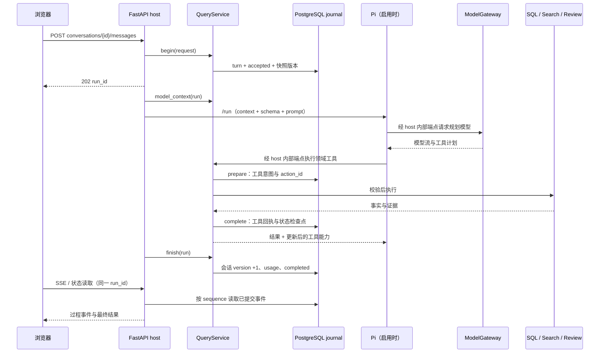

# 查询数据流与状态契约

本页描述 QueryService 主链；启动模式与 legacy 分支见 [系统架构](system.md)。
一次查询的最终事实由 host 工具与已提交回执决定，模型输出是待校验的计划或参考回答。
返回 [知识库入口](../README.md)。

## 从用户消息到最终回执

图展示启用 Pi 的自然语言主链；Pi 的多个工具步骤仍受单轮预算控制。
`execute_query` 也可采用 Jev/注入 planner，或经 `ModelGateway.plan` 直接生成 JSON；这些分支共用 host 执行器。
结构化 `POST /api/questions/list` 生成 `StructuredQueryRequest`，直接执行 LIST 并保存同类回执。

## 用户目标、工具执行与回答完成

v16–v18模型协议首先声明独立 `user_goal={objective,response_mode}`。v17将 `DIRECT_RESULT` 限定为单范围、一份回执即可满足全部交付项；同范围的去重题数与提问次数属于一份计数结果，多公司、多范围、清单加总量及比较/解释等用 `SYNTHESIS`。v18明确将归纳步骤、方案及验证放在模型建议中，不归为原题要求。host绑定当前run、请求hash及来源，后续步骤不能改写或降级目标；目标字段不授予筛选、题目ID或复习写入权限。新自然语言入口先规划目标，不走未声明目标的集合/Jev直达路径；结构化UI仍直接执行SQL，旧提示词和typed adapter保留显式legacy兼容。模式仍由模型按完整语义选择，host的结构性 COMPLETE 不证明全部语义目标正确，真实诊断及复测见[20组记录](../plans/2026-10-15-evaluation-readiness.md#20-组真实多轮诊断2026-10-26实施前)。

每步 `action` 只表达工具操作，`final`只作结束提议。工具执行并提交事实后，host计算 `meta.completion`：综合目标的读取保持 `NEEDS_RESPONSE`，明确继续读取为 `CONTINUE`；`ANSWER`完成为 `COMPLETE`，澄清为 `CLARIFICATION`，已提交复习写入为 `WRITE_COMMITTED`。Pi、`finish`及同请求恢复均按持久completion决定终态，不能从旧plan.final推断新协议已经回答完成。预算耗尽保留partial并失败，不写SUCCEEDED；这些结构检查不证明任意自然语言的目标识别和回答语义正确。

多轮可在原有工具8次、配置规划次数、共享调用/token及截止时间内继续；没有固定两次读取限制，后续调用不重置预算。规划调用上限（默认8）与包括embedding/rerank的共享上限（默认24）分别配置，Pi接收host的剩余规划上界。当前页写入绑定请求开始页；明确查询目标题并标记可绑定首个合法结果页，绑定后读取或换页不能扩大授权。

2026-10-25预算调整后，整轮默认600秒/256000 tokens；`QUERY_MAX_TOTAL_MODEL_CALLS`控制共享调用，规划仍由`QUERY_MAX_MODEL_CALLS`独立限制。持久run状态返回`lease_until`，浏览器据此设置等待期限并保留传输余量，避免后台仍合法执行时被原210秒固定看门狗取消；刷新不重置已过时间。该调整不改变普通SEARCH候选上限、来源核验、回答预留或复习写入授权。

`tool_policy.model_budget` 同时公开剩余规划/共享调用、待发生的下一次规划、搜索基础成本及综合回答预留。菜单和最终host动作校验均移除无法留出回答调用的读取；最后一次规划只能做终态动作，零模型SQL读取也不能绕过后续回答成本。搜索基础成本为BM25零次、DENSE/HYBRID一次、HYBRID_RERANK三次；附加核验仍受工具阶段provider门的一次回答预留保护。未声明目标前保留单规划DIRECT_RESULT的工具可见性，执行绑定综合目标后才强制预留。预留只针对调用数，token/期限仍由原硬限判定，不能承诺每次一定有足够时间或token回答。

ANSWER可用 `evidence_tool_ordinals` 引用本run已完成工具，序号来自持久回执，失败造成的空洞不按数组下标补齐。缺题ID的零结果、计数和范围分析也可引用合法工具证据；历史回执、失败或UNAVAILABLE检索不能冒充当前事实。现代模型目标的CORPUS/MIXED无题目引用时必须明确引用工具回执，读取后不能改用GENERAL_KNOWLEDGE规避证据门。

模型摘要保留有界候选数、资格范围数、返回数、核验状态与 `result_completeness`，明确候选核验完成不等于全库覆盖完成；合法0/false保留，缺失值为未知。至多8个完成工具的简要证据保留，来源长文只留最近3步且可压缩；复习状态至多展示5项，同时保留请求集合的状态汇总、非法数和截断标志。原API完整事实不被摘要替代。工程入口见 [goal_contract](../../src/interview_intelligence/agent/goal_contract.py)，验收记录见 [本次计划](../plans/2026-10-19-query-goal-completion.md)。

v16–v18的Pi模型输入显式采用 `query_step_v1`：把完整QuerySpec共享schema声明一次，避免每个工具重复传FilterSpec。模型仍逐步选择action，Pi按host当前允许action映射原领域工具；动态预算收缩、host执行校验与持久工具身份不变。传输版本通过 `model_wire` 事件记录，旧菜单及JSON fallback保留。schema去除标题/默认值注解不删除类型、必填、枚举、范围或条件约束；重复声明减量不证明上游首输出延迟必然同比下降。延迟应分别核对provider TTFT、本地queue/interval及生成结束时间。

入口符号：[app.js::agentQuery](../../src/interview_intelligence/web/assets/app.js)、
[api.py::conversation_message / execute_query](../../src/interview_intelligence/api.py)、
[QueryService.begin / execute / finish](../../src/interview_intelligence/agent/query_service.py)。

## 工具与事实范围

| action | 执行与完整性边界 |
| --- | --- |
| LIST / NEXT / STATS | SQL 路径在完整匹配范围聚合、排名和分页；NEXT 也可读取已持久化的语义候选页，完整候选工集尚有未处理题时可核验下一批；SQL 与语义 cursor 不能互换 |
| COUNT | `count_questions` 计算完整当前范围，返回去重题数、提问记录数等；不能用 `top_n` 限定 |
| SEARCH | 普通搜索在 SQL 资格范围内召回至多 50 个候选；明确全量工程集合后细化业务范围的路径保存完整候选工集并分批核验。候选资格全集与业务归属结论分开，不提供未经核验的全库 Top N 承诺 |
| DETAILS / REVIEW_STATE | 读取当前页指定题目；复习状态另支持有界 full_scope，最多 1000 题 |
| ANSWER | 模型参考回答；引用只可来自当前页，CORPUS/MIXED 需题目或本轮聚合证据 |
| RECORD_REVIEW | 当前请求明确授权、当前页范围、幂等批次写入；必须终结该轮 |
| CLARIFY | 保存澄清问题与选项，终结该轮，等待下一条用户消息 |

结构校验入口是 [query_contract.py::QuerySpec / validate_model_plan](../../src/interview_intelligence/agent/query_contract.py)。
静态动作、字段投影和必填声明以 [tool_definitions.py](../../src/interview_intelligence/agent/tool_definitions.py) 为唯一编辑来源；运行 `python scripts/sync-tool-contract.py` 生成 Pi runtime 标记区，`--check` 检查漂移。Pi 的工具顺序和 ANSWER 额外必填字段显式保留，主机 `QuerySpec` / `validate_model_plan` 继续独立校验；详见 [10-16 契约收敛](../verification/2026-10-16-tool-contract.md)。
权限最终由 [harness.py::ToolPolicy.require](../../src/interview_intelligence/agent/harness.py) 和 host 检查执行，不能靠模型声明获得。
自然语言 COUNT/LIST/STATS 可消耗规划模型调用；执行 SQL 工具本身不等于整轮无需模型。

默认提示词把精确类别榜单交给 LIST，按主题、公司或轮次看分布交给 STATS；单一大类的内部知识点分布使用 `topic_level=L2`。
“工程系统设计题，类似设计排行榜”普通找题按宽类别 SEARCH，例子不是每题的必需对象；明确“所有/全部/完整工程系统设计题”使用 `LIST + semantic_task=ENGINEERING_DESIGN`，不受 SEARCH 的 50 候选上限限制。“只要排行榜”保留具体对象的检索范围，“排行榜如何设计”则生成 ANSWER。
`coding_focus=ENGINEERING` 表示工程编程任务，不能代替系统设计类别；题型偏好可以参与软召回，用户显式筛选仍须保留。
这些是 [默认规划提示词](../../prompts/query_agent_v18.md) 的行为约定，实际计划还要经过 host 校验，不等于每个模型请求都已正确执行。澄清选项属于助手建议，不形成新增筛选要求；用户已经给出可执行的新范围时，不应因未选旧选项继续追问。宽工程设计包含符合任务要求的传统工程及 Agent/AI 应用，也可包含有建设目标的组件、机制和工作流；纯概念、算法求解和既有项目复述不能仅凭标签纳入。

[query_scope::guard_plan](../../src/interview_intelligence/agent/query_scope.py) 从用户原话及可信续问恢复相关性目标，模型扩展只用于召回；无对应用户授权不能添加 `ALGORITHM_PROBLEM` 或 `ENGINEERING_DESIGN`。完整工程设计请求及其 COUNT/STATS 续问由 host 恢复对应 SQL task；其他自然“场景/设计题”不能直接等同旧 `SCENARIO/SYSTEM_DESIGN` 标签，普通找题仍可转语义 SEARCH，缺少可靠全集的其他总数或全库排名请求仍须澄清。显式 UI 和文字指定的分类标签保留，不能用有限候选替代全库事实。回执 `meta.user_scope_policy` 保留提案、实际范围与来源。

Python直出计划的模型schema为`QuerySpec_v3`，v16–v18另要求非空user_goal；非LIST/NEXT/COUNT/STATS动作的`semantic_task`只能为空，SEARCH同时要求非空查询、每页至多50、`top_n=null`。Pi使用动作专属工具字段，旧提示词仍可走旧typed字段兼容。模型可见schema不代替主机严格校验：冲突计划在工具之前失败，不静默删条件或改动作。私有`model_response`先留原计划，公开错误使用稳定`QUERY_MODEL_PLAN_INVALID`，不会带出Pydantic的原始input。

可信 UI 筛选另以 `query_scope_intent.explicit_filters` 记录，旧会话可回退到 `list_explicit_filters`；模型推断条件不能转成 UI 来源。续问 COUNT/STATS 保留这些条件，当前显式变更优先。用户指定前 N（1–1000）与每页 N（1–100）时分别控制集合上限和页大小，超界澄清，不静默截断；未指定前 N 的完整请求使用 `top_n=null`。分组 NEXT 恢复原 `group_by/topic_level`，避免将公司数说成去重题数。

技术解释、概念比较和解题可直接 ANSWER；“第二题怎么回答”先读取当前页的对应 DETAILS，再生成参考解答。
根据题库制定复习建议时，先以 `final=false` 读取所需 COUNT/STATS/LIST 等事实，再用 ANSWER 终结。
ANSWER 不向题库新增题目或标准答案，最多引用当前页 10 题，host 重新读取并验证范围。
`CORPUS/MIXED` 必须有有效题目引用或本轮聚合证据，历史 COUNT 回执不能冒充本轮证据；没有题库依据的解释标为 `GENERAL_KNOWLEDGE`。
题干来源只能证明题目出处，不能证明生成解答正确。约束与对应测试见 [QuerySpec](../../src/interview_intelligence/agent/query_contract.py)、[回答集成测试](../../tests/integration/test_intent_answers.py)。

## SEARCH 与 SQL 全集的区别

工具执行后的答案文案与响应结构由 [query_response::build_query_response](../../src/interview_intelligence/agent/query_response.py) 生成；facts 与 warnings 保留主机对象引用。QueryService 继续负责范围/权限检查、会话状态、预算和 journal，呈现函数不承担这些职责。

1. `search/service.py::eligible_canonical_ids` 从当前 SQL 事实计算匹配 ID，超过 50,000 拒绝。
2. `ElasticsearchRetriever.retrieve` 对该 ID 集合执行 BM25、DENSE 或 HYBRID；混合召回用 RRF。
3. 混合候选池最多 50；可选 lexical facets 与题型偏好影响候选构成，不扩大 SQL 资格范围。启用 SYSTEM_DESIGN 软偏好且有 facets 时，保留广召回前10与偏好新增30，再用偏好资格内的建设动作词法支路补充剩余位置；原查询以独立软评分子句保留，原 facets 继续提供排名与回填。支路的查询、权重、来源和数量保存在 meta，不改变语义核验目标或 SQL 硬条件。
4. HYBRID_RERANK 调用 reranker，使用候选原文上下文、相关性和范围核验；模型调用不经过 Pi 网关。
5. `search_questions` 再校验返回 ID，调用 SQL `get_question_detail` 回填题文、真实频次与来源。
6. QueryService 按 requested/executed pipeline、核验完整性和 invalid candidate 结果决定能否成功。

### 澄清后的题意范围与候选分页

[relevance_scope](../../src/interview_intelligence/relevance_scope.py) 从可信用户原话编译 `query_relevance_scope_v1`：保存 `source_messages`、带消息序号和逐字 quote 的目标/排除/独立要求证据，以及内容身份 `scope_hash`。默认不排除 AI、Agent 或 MCP；“具体业务系统设计”约束交付目标，不能自动变成“传统”“非 AI”或“独立完整系统”。排除动作必须直接绑定对应领域，后续解除或重新排除按消息顺序生效；“不要 AI 来决定分类”等行为限制不构成排除 AI 题。验证时重算原话授权，hash 一致本身不授予权限。

`BUSINESS_APPLICATION` 包括具体业务应用、业务流程/功能及 AI 业务应用，通用缓存、ID、队列或推理运行时本身不能替代业务目标；用户明确要求独立系统才设置 `independent_only=true`。`ANY_ENGINEERING` 也可带明确独立要求或领域排除，不能因目标单位较宽而丢掉这些约束。模型的 `search_query` 扩展、题型/主题推断和浏览按钮都不能新增授权；“按题意查找候选”仅选择 `retrieval_mode=CANDIDATES`。

仅原话授权为 `BUSINESS_APPLICATION` 且已选择 `CANDIDATES` 的 HYBRID_RERANK 路径启用完整目录软筛选：同一 PIT 枚举工程软先验的全部标准题完整标题，逐项核对 SQL 的精确数量、ID/text hash、语料、索引 schema 和 embedding 版本；目录不取前 N，也不截短标题。关 PIT 后，[catalog_selector](../../src/interview_intelligence/search/catalog_selector.py) 复用已选重排模型的 client、共享锁、预算、stream 和回调，只按给定 alias 提名最多 40 个新增候选，替代第二次目标 embedding；保留原资格宽召回前 10，总池仍至多 50。标题只作软排序，不能充当后续任务、交付单位、业务目标或领域证据，未选题也不成为负例。目录不完整、投影过期、输入或请求预算不适用时明确记录 fallback；新路径复用已取得的 base-vector 和目标词法候选，不增加隐藏的第三次检索模型调用。无可用 selector 的替代后端保留旧目标 embedding 路径，并明确未应用目录筛选。

目标目录以同一 occurrence 筛选下的 `ENGINEERING_DESIGN` 确认及待核验来源形成 `target_eligible_ids` 软先验；缺审、过期和异常来源保留，另一轮次的确认不能借给当前筛选。宽支路始终保留原 SQL eligible ID 集，旧审核负例和未审来源仍可进入，不能保证宽支路第 10 名以后的题入池。先验与目录曝光不证明业务应用归属或业务全集，不增加 topic/type/AI 硬筛；仅领域排除、独立要求或模型软改写不能启用目录筛选。短支路按既有偏好、facets 和宽召回回填。

检索词与证据串分开：候选按钮、重查和澄清后的续问使用原用户语义消息作为有界软召回词，不把“用户此前原话”等审计标题送入检索；完整有序原话仍保存在同一用户范围和两级语义判断中。新的业务条件使旧软扩展失效；复用扩展须匹配当前范围hash，`semantic_recall` 标明原话/模型软扩展来源及非硬约束属性。

`target_eligibility` 记录 `engineering_recall_prior_v1`、当前语料/标注版本、审核 scope hash、覆盖计数、目标 ID 数量/摘要和 requested/available/applied/fallback；无有效审核时显式退回宽目标召回。支持该能力的后端必须确认应用同一 ID 摘要，否则明确失败；不支持先验的替代后端标明 fallback，不能声称先验已应用。query、支路数量、选入来源与用户 scope hash 继续进入 meta；不支持用户 scope、未确认应用用户 scope 或目标支路失败时明确失败，不静默回到旧候选池。这个先验不增加 embedding 调用。

初次运行另保存私有 `retrieval_rank_audit`（`bounded_retrieval_rank_audit_v1`）：宽/目标各至多 200 个融合排名、每阶段至多 100 个，记录 canonical ID、阶段排名、选入来源和计数摘要，并绑定用户 scope、资格集合摘要和审计 hash。主机核对包括未入池行在内的全部 ID；审计不含原文或用户消息，不投向 harness/模型，也不复制到候选快照后页。它完整记录的是本次有界检索命中，`exhaustive=false`，不能当成全库业务集合。由此区分目标支路未召回与候选池截断，无须扩大模型输入或再做 embedding。

`catalog_selection_audit` 独立记录完整目录 hash、数量、projection fence、完整请求/schema/output 的保守预算与 prepared hash、软提名 ID、实际应用及 fallback，不伪装成 ES 排名。`attempted` 只表示进入筛选调用分支，`provider_admitted` 才表示经过共享 gate 进入 client；失败仍留回调和保守 charge。两种私有审计都不送入主排/核验模型或快照后页。整轮按当前配置（默认24 calls / 256k / 600秒）逐阶段实际结算再准入；一次目录请求可容纳不证明新 50 题的原问主排/范围核验也可容纳。后续核验预算不足时，已选候选保留为 PENDING。

同一 host scope 进入主排和独立范围复核。工作区候选为 `rerank_v42_source_activity_reference` / `scope_verify_v25_source_activity_reference`，以当前原问的交付单位、业务活动、目标及授权领域排除证据核查；紧凑 wire/schema 仍须绑定最终候选身份验证，不能以减少字段改变语义或省略授权。范围判断冲突、证据不足或核验异常在预算内有界补核验，仍未决的候选以 `relevance_scope_status=PENDING`、原因和同一 hash 保留；确认项为 CONFIRMED。它与语料归属审核的 `semantic_verification` 是两个维度，不能相互代替，待核验项也不冒充已确认结果。

`business_scope_v7_source_activity_reference` 将证据结论分成 POSITIVE、NEGATIVE、INSUFFICIENT。业务正证另以 `business_activity_evidence`（wire `p`）绑定实际要求实现的业务行为、状态或处理结果，技术吞吐、隔离等指标不能单独替代业务活动；同一充分原句可复用，不要求不同引文。技术负证必须落地所问技术产物与技术能力，不能只凭背景使用者、泛化动作或缺少建设动词排除。混合平台、所选片段过短或跨字段冲突保持待核验，并在原预算内按同源证据补核验。来源加载器存在即对每个候选设置 `source_context_required=true`；来源版本、required 标记或上下文契约已存在但原问为空、缺失或无效时，不回退标准题证明。只有确无来源契约的旧直接调用保留 canonical-only 行为。

主排判负同样只是临时判断，不能跳过独立范围复核；全负批次也必须逐题复核当前任务、所问交付物和目标关系。最终硬排需要主机生成的 `scope_adjudication_contract=clarified_independent_scope_v2`、`scope_adjudication_status=VERIFIED` 和实际负类复核回执，并绑定当前 scope hash 与完整同源负证覆盖；工作集的 ES 与 SQL 消费层同时检查，旧 `source_verified_negative` 布尔值不足以排除。没有来源、没有预算、复核失败或未执行的题保留 PENDING。首轮负判被纠正为正类时，另需 fresh 同源相关性证明，不能拼接旧负判的相关轴。有效来源明确表示混合交付边界未决时保持待核验，不把这个语义结论当格式错误反复补问以求二分；合法领域排除和显式独立要求仍按授权及来源证明生效。

范围阶段独立判断当前所问任务及交付物与业务目标的关系，审计保留 `scope_candidate_task`、`scope_task_evidence`、`artifact_goal_relation`，不覆盖主排诊断。来源必需时只能用实际原问编号作任务证据，目录标题和主排先前选择都不能代替。澄清范围的紧凑wire省略前后文展示字段，主机仍保留完整来源和审核；预算内优先独立裁决可处理候选，未处理项公平保留待核验，不因修复尝试挤掉必需复核。

首次独立范围复核不携带主排语义标签；有界修复才提供暂定判断和主机失败字段，联合重审任务、单位、角色、业务活动与相关关系。同一来源上的语义纠正不要求出现新的原文字节，也不能把重复标签当成新的证明。

`candidate_source_context_v4` 为明确回指的当前问提供至多四个最近、连续的前件，另为明确编号条目提供单独校验的后置要求；两者分别保留 frame 类型、来源 hash/span/order 与引用槽，不拼成当前原问。当前原问优先，所有原问及正式 frame 共用每题 500 UTF-8 bytes；缺源、不完整、歧义或超预算不能跳过近问再借远问补证。独立 scope 的 `z` 声明当前锚点、选定槽和唯一性；主机验证来源与结构，唯一语义归属仍是模型判断。任务、建设和领域证据始终来自当前原问；只有经过合法 frame 声明的单位、目标、活动及查询关系可引用前件或条目要求，普通 `context_before/after` 仍不作证明。

v40 允许范围阶段用新的、逐字落地于同一原问的对象与关注点证明重新核查主排未决的相关性轴；只给业务正标签不能生成相关性证明，原始主排诊断和评分继续保留。连续引用按当前原问的实际片段解码并校验同源、连续边界与合法索引；去空白后的 quote 同步 span。同源的有效交付证据可同时证明任务与建设行为，不要求重复两份完整表述；编号项的主语片段不能单独证明业务目标。最终失败先进入补核验候选，再按失败类型和原排名公平选择实际剩余预算可容纳的子集，未解决项仍保留待核验。

[search_pagination](../../src/interview_intelligence/agent/search_pagination.py) 把一次查询的至多 50 个可见候选保存为 `semantic_candidate_pages`，按 `pagination.kind=semantic_candidates` 分页；`scope_candidate_counts` 分开给出 confirmed/pending/visible。签名 cursor 绑定用户、会话、来源 run、scope/result hash、版本、筛选和页大小；NEXT 读取同一快照，不重新召回或重复澄清。重查恢复原话目标并重新检索，新目标清除旧候选和推断条件；明确切换完整工程集合才离开该范围。

浏览器刷新从持久化回执恢复候选标记和下一页；聊天与题库页均按 `meta.pagination.next_cursor` 提交同会话自然语言续页，候选 cursor 不送往结构化 SQL 列表。题库筛选/排序/页大小变更通过带 `requery_of_run_id` 的请求重新检索；查询服务关闭时明确提示。页面分别展示业务范围确认/待核验和原因，投影只保留有界状态、原因、hash 和计数，不传来源全文或签名 cursor。

### 全量工程集合细化后的完整候选工集

用户原话明确请求全量工程集合，并进一步选择业务目标和“按题意查找候选”时，[complete_workset](../../src/interview_intelligence/agent/complete_workset.py) 在核验前持久化完整 SQL 资格 ID、顺序和源绑定。单句“所有工程系统设计题 具体业务系统设计”也可提供全量授权；单独业务目标不能借用工程软先验缩小普通 SEARCH。目录提名只排优先顺序，未提名题继续留在工集。

[search/service](../../src/interview_intelligence/search/service.py) 每次提供至多 20 个候选的有序窗口，与显示页大小分开。调用模型前以本轮剩余预算准备完整主排和必要的独立范围请求，选择能容纳的最长来源就绪前缀；不删原文、证明字段或提高预算。只推进实际处理的连续窗口前缀，尾部保持 UNPROCESSED，在后续 NEXT 继续。窗口内来源异常保留 PENDING；第一道来源就绪题也无法容纳时，零模型处理至该题为 PENDING，避免无限停在同题。候选状态为 UNPROCESSED、CONFIRMED、PENDING 或 EXCLUDED，每个实际处理 ID 都必须有结论。来源仅来自同条件下的工程资格 occurrence。一个标准题有多个合格原问时，一个有效正证可确认；排除必须有覆盖所有合格原问的有效负证，超过默认两次来源展示上限的未展示原问不能默认为负例。`frequency_basis=engineering_qualified_occurrences` 表示工程范围提问次数，不能称为业务提问频次。

签名工集绑定用户、会话、原始授权、scope、筛选、版本、页大小、完整 ID 和状态摘要；证明策略另绑定重排/范围/业务版本、实际两份 scoped 提示词 hash、`workset_source_policy_version=engineering_workset_source_proof_v4` 及 `workset_batch_policy_version=engineering_workset_adaptive_prefix_v1`，旧消费政策不能复用缓存。来源摘要也绑定合格题所属面试的当前原问、build、顺序、span、原文 hash 及所消费的追问关系，避免筛选外的前件无版本改动后继续使用旧证明；这些上下文不加入题目资格。缓存续页、回执 GET 和刷新不调用模型；尚有未处理题的 NEXT 是新的正常预算请求，无规划或重复澄清。每批结果和进度写入持久化回执，分别记录提供的窗口和实际处理前缀，可恢复已提交批次。已见结果按稳定顺序追加；整批排除但还有未处理题时返回进度及继续入口，不能称为“没有结果”。

核验前另保存签名批次执行意图。恢复时只有意图却没有持久化结果，返回 `WORKSET_BATCH_OUTCOME_UNAVAILABLE`（409、不可自动重试），原范围及未处理题保留，不能自动重复供应商调用；显式新请求重查可验证原工集授权后重新执行。旧 FAILED 请求还须匹配原接受时的会话版本，不能覆盖后来的新目标；SUCCEEDED 回执仍可只读重放。供应商返回和数据库提交之间的不确定窗口不能承诺故障下 exactly-once 完成。首轮缺陷和独立复验见 [工作记录](../retrospectives/2026-10-08-query-scope-narrowing.md#10-17-系统性修复工作记录)。

公开 `candidate_workset_progress` 分开给出候选总数、已处理、未处理、确认、待核验及排除数；候选总数不是业务题总数。选择全量后的重查保留目标和模式，筛选变化在完整资格集合内重建，页大小变化可复用现有工集，新目标清理旧状态。聊天和题库页从持久化回执恢复继续核验/缓存翻页按钮；模型投影只保留经校验的聚合及状态，私有 manifest、逐题状态表、原话授权和 cursor 不进入模型上下文。

这些是当前工作区候选，v42仍在完成工程与真实验收，尚未部署；线上仍为 rerank v15 / scope v6。v41首组真实23题精确分类17/23，严格门禁未通过，原gold与评分器保留；不得以离线通过代替真实语义验收。既有 SQL 工程全集路径独立保留：10-16 的 r295/i295/a32 回执覆盖 320 道可见题（301 确认、19 待核验），不受普通 SEARCH 的 50 候选预算限制，见 [SSH 发布证据](../deployment-ssh.md#当前发布版本)。

请求 HYBRID_RERANK 而核验不可用时，QueryService 不把未核验候选确证为成功匹配；明确业务候选路径的预算不足项仍可作为 PENDING 保存及分页。
SQL eligibility 已证明空集时，不调用检索或模型，返回可重放的成功空结果并记录 `verification_basis=empty_sql_scope`；这不代表执行过模型核验。存在 eligible 题目但核验失败时仍拒绝成功。
普通旧 SEARCH 可剔除结构异常候选并返回经核验的部分结果；澄清 scope 路径则保留未决候选为 PENDING 并分开计数。两者都不得把“部分”写成“完整”。
对象、关注点和任务证据采用候选局部连续片段 ID，主机解析后仍逐字校验；旧 literal 引文保留同样的严格校验，不能自动修补标点、拼接或省略号。
候选来源上下文仍限同条件下至多两次 occurrence、合计500 UTF-8字节；先保留原题，再按旧上限分配前后文，超限原题保留连续前缀并标记不完整。存在已验证原问时，标准题改写只有逐字存在同一原问才可证明正向任务；模型可选同原问最小连续片段范围，不能跨编号新题或借邻文补建设/场景任务。
任务证据无法落地标为 `INVALID_TASK_EVIDENCE`，与语义任务不符的 `TASK_REJECTED` 分开；独立设计范围复核也用候选本地建设/约束片段，约束只能从符合原规则的片段中选择。无法落地、重复重叠或分属不同题目的约束证据标为 `INVALID_DESIGN_EVIDENCE`，原文真实但不符合设计单位政策的拒绝另记 `scope_host_reason`，不改写模型理由。证据与结构异常分别计入 `invalid_evidence_count` / `invalid_schema_count`，按候选汇总为 `PARTIAL`。
所有设计单位还校验所选目标实际覆盖的原问子句：host保留并重核片段位置与occurrence，不能以同词、另一子句或另一来源的建设要求救回解释片段；长句尾部的解释框架也须参与判断。真跨标点任务、解释后新增交付及COUPLED可观察目标保留；截断而语境不足时记证据不足，不能据此强判全题负例。来源位置是host内部元数据，不进入模型schema。
宽工程设计允许组件、机制与工作流的明确交付任务，只有用户原话要求独立系统时才启用较窄单位政策；模型的任务标签不能代替该授权。同原问的连续片段范围可证明跨标点的建设目标，不复制或拼接不同题目。自然场景查询另要求同一原问中的应用情境与诊断、处置、设计或取舍证据，纯概念/机制介绍不能因 `KNOWLEDGE` 或故障名通过；缺新证明仍为部分核验，不把未知算作负例。
宽工程中被主排标成 `CODE_TASK` 的真实工程交付，只有原问已有工程对象与建设要求才可继续独立范围复核，相关性阈值照常生效；纯算法与显式独立/架构设计口径不适用。场景可包含给定故障或状态下的后果、行为与必要性验证，仍须当前原问同时给出情境和应用问题，不能把一般原理问扩成场景。
v34 对主排已确认正向任务、仅因证据内容或证据字段格式失败的候选增加一次有界补核验，恢复后仍须独立范围复核；有效语义负例、任务枚举错误、缺字段等其他 schema 异常不因此转正。独立设计复核的正向证据异常仍最多补核验一次。两阶段沿用候选局部引用、共享模型锁和累计请求预算，完整 messages（含 system）与动态 schema 均计入保守 UTF-8 字节上界和输出预留，不进入传输重试。初始诊断和修复结果同时保留，未解决候选标为 PARTIAL 并记录待决 ID，不能当作已确认负例。
范围补核验需剩余至少23秒（执行20秒、返回预留3秒）；主排证据补核验还为必要的独立范围复核预留一次调用、完整 token 上界和20秒，因而至少需43秒。可选调用的协作期限至多30秒且不超过父期限减去后续预留；不足记 `SKIPPED_TIME`，迟到记 `TIMED_OUT`，保留已验证部分。排队、锁文件重试、间隔、流片段与返回均检查同一父取消/期限和子期限，父取消或超时仍使整轮失败。同步SDK的read timeout按单次I/O计，阻塞读取尚不能被严格墙钟中断；上述子期限是协作检查，并非30秒硬保证。
主排也按完整 messages、来源与动态 schema 计算同一保守上界，传输重试不能只预留候选正文；按原查询需要注入算法或严格独立设计规则，仍保留独立二次核验和 Top50 范围。已有耗时可用 [profile-latency](../../eval/README.md) 拆解，输入 bytes 变化不等于真实推理提速。

算法审计更正的旧入口 [semantic_audit](../../src/interview_intelligence/analytics/semantic_audit.py) 仍只向内存 SQLite 投影。完整来源审核的通用导入入口见下节；运行版本、审核物与数据库发布须分别绑定，不能只更换重排器便宣称修复 SQL 全集。

合法负例的空证据不算结构或证据异常。普通旧 SEARCH 异常后没有可交付题目时仍核验失败，不能保存成功空集；澄清 scope 的待核验可见项不是“已确认空集”。
SEARCH 回执的 `result_completeness` 分开记录候选核验完整性、异常计数与展示截断；普通检索的 `corpus_complete=false`，即使所有候选核验完成也不承诺覆盖全库。文案明确候选范围，部分结果另显示异常提示；只有 SQL 资格已证明空集时使用 `empty_sql_scope`。
具体约束见 [query_service.py::_execute / finish](../../src/interview_intelligence/agent/query_service.py)、
[elasticsearch.py::retrieve](../../src/interview_intelligence/search/elasticsearch.py)、[reranker.py::LLMReranker](../../src/interview_intelligence/search/reranker.py)。

SEARCH 的 `frequency` 先核验最多 50 个候选，再按候选在当前 SQL 范围内的 occurrence_count 排序。
它表达“本次候选中的高频”，不表达“全库最高频”；后者应使用完整范围 SQL LIST/STATS。
## 完整语义集合与来源审核导入

`ALGORITHM_PROBLEM` 与 `ENGINEERING_DESIGN` 使用各自版本的 occurrence 级语义证据，原始 `QuestionOccurrence` 与归并 `CanonicalQuestion` 保持分离。审核范围是当前 active build、INCLUDED 文档和 analytics eligible 面试内满足全部筛选的 occurrence，既要有 ACCEPT，也要有 REJECT；已有标准题、旧标签或已知正例不能替代逐问范围证明。

[semantic_scope](../../src/interview_intelligence/analytics/semantic_scope.py) 核对 task/version、`semantic_input_hash` 和原文引用。[listing](../../src/interview_intelligence/analytics/listing.py) 在该范围内聚合标准题、来源次数与频次排名，使用绑定请求范围、语料/标注/用户版本和语义 scope hash 的签名 cursor；NEXT 读取原列表，能够遍历超过 50 道题。列表的标准题总数与 occurrence 提问次数分开，COUNT 不以当前页大小为总量。

工程集合将有效 ACCEPT 与待核验 occurrence 一并分页展示；UNRESOLVED、缺审、过期或非法证据均保留待决，`scope.complete=false`，并分别记录 pending/unresolved/missing/stale/invalid 数量。`ALGORITHM_PROBLEM` 仍要求完整二态审核，缺失或异常时拒绝交付完整集合。工程行的 `semantic_verification` 为 CONFIRMED 或 PENDING，分别给出 `confirmed_occurrence_count`、`pending_occurrence_count` 与带原问及原因的 `pending_sources`；已确认的标准题也可能有待核验来源。

`meta.semantic_counts` 分开记录 `confirmed_canonical_questions`、`pending_only_canonical_questions`、`pending_canonical_questions`、`selected_canonical_questions`、`confirmed_occurrences`、`pending_occurrences` 和 `selected_occurrences`。分页总数表示可见的已确认与待核验标准题，不能冒充已确认语义总量；频次与排名仅使用已确认 occurrence。COUNT 只有在完整审核时才给精确语义总数，不完整时同时说明已确认数量与待核验范围。

工程 LIST 的可见去重题数超过 `QUERY_COLLECTION_SELECTION_THRESHOLD`（默认100）时，host 先保存数量预览和浏览选择，返回 CLARIFY；计数基于原排序、前 N 和复习条件处理后的实际集合，COUNT/STATS 不触发这层数量澄清。用户可选全量分页或按已有主题浏览，明确选全量后，同范围续页、重排和重查保留选择；新范围重新评估。预览会撤销旧页的题号、详情及写入能力，不能把“下一页”误接到上一轮列表。

[CollectionSelection](../../src/interview_intelligence/agent/collection_selection.py) 将原 typed 计划、用户原话、显式筛选来源、版本、分类指纹与选择保存在会话 `collection_selection`，主机在所有工具入口恢复可信选择；模型不能伪造选择或分类。结构化 UI 请求单独记录其授权来源。菜单遇到版本或分类变化时更新选择，未识别的分类入口重新显示菜单；幂等回执和会话 version 仍约束竞争提交。

[engineering_collection_categories](../../src/interview_intelligence/analytics/engineering_categories.py) 按当前匹配原问的既有 taxonomy L1 组织互斥的标准题分桶。任一匹配来源待核验则进入“待核验”；缺失、未知、版本不符或跨 L1 冲突则进入“分类不明确”，其余按既有主题展示。分类名不构成新的语义审核结论，也不会因“算法/项目”等旧主题名而把已纳入工程集合的题目排除。分类在原 Top N / 复习集合之后筛选 canonical，保留该题所有匹配的确认与待核验来源，所有分桶并集等于原可见集合。

类别列表使用主机字段 `ListRequest.collection_category`，不进入模型 `QuerySpec`；签名 cursor 额外绑定分类及来源 taxonomy 指纹。`meta.list_request` 保存准确的结构化续页请求，`meta.collection_category` 分别给当前类别与原集合计数；当前分类的 COUNT/STATS/NEXT 使用同一标准题集合，分组续页不能恢复成全库。页面保留全量、分类不明确与待核验入口，不截断长分类菜单。

确认/待核验状态与计数继续进入有界模型证据和当前页摘要，来源全文与 cursor 留在主机回执。页面按题目或分组展示待核验原问与原因；详情遇到结构无效的 span 时保留原问和计数，在 `source_issues` 标明 `source_evidence_verified=false`，不构造已验证引用或来源定位按钮。

独立来源审核物由 [semantic_scope_import](../../src/interview_intelligence/analytics/semantic_scope_import.py) 绑定精确 occurrence ID 集、语料和标注版本、原始及解码 hash、字符/行 span、reviewer 身份与时间、manifest 和 payload hash。通用 [导入脚本](../../scripts/import-semantic-scope.py) 使用项目 Settings/DB，默认 dry-run；明确 `--apply` 后在事务内写入，保留其他分类、其他 task 和旧决定历史，新建 annotation 的旧分类仍是 UNKNOWN。完全相同的重复导入不递增 annotation revision。

导入前必须落盘不可变 manifest、PREPARED 回执与 rollback evidence；审计文件写入失败会回滚数据库事务。只有返回 APPLIED 才表示数据库提交，PREPARED 文件本身不证明提交，文件与数据库没有跨系统原子事务。ENGINEERING_DESIGN 可导入来源绑定有效的 UNRESOLVED，导入后的 scope 保持 `complete=false`；遗漏、集合/版本/来源绑定错误或非法引用仍拒绝导入。ALGORITHM_PROBLEM 保持完整 ACCEPT/REJECT 二态要求。hash 一致与审核者为 agent/human 不能单独证明语义质量。

## scope 来源与继承

| 来源 | 保存或投影位置 | host 处理 |
| --- | --- | --- |
| 本次 UI 显式筛选 | request filters 的字段存在性、`resolved_explicit_filters` | 计划不得静默冲突；显式 null 可清除对应范围 |
| 当前用户目标 | `conversation_focus`、当前 message | 目标可不同于仍保留的分页范围，例如列题后追问总数 |
| 浏览方式选择 | `collection_selection`、主机分类指纹 | 保存原集合与已选全量/类别；筛选变化不复活旧选择，分类与待核验集合保持可达 |
| 澄清题意与候选方式 | `relevance_scope`、原话 ordinal/quote/hash | 目标、明确排除和独立要求有来源；候选选择不改变题意，旧宽集合菜单不能覆盖续问 |
| 有限语义候选分页 | `semantic_candidate_pages`、`list_request.kind` | 至多 50 个确认/待核验候选的持久化快照；签名绑定身份和版本，不当作 SQL 全集 |
| SQL 列表与当前页 | `list_request`、`current_page_ids`、`list_goal` | NEXT、题号指代、详情和复习操作的依据 |
| 可继承的检索筛选 | `question_type_scope`、`search_filter_scope` | 保存 explicit_ui / sql_list 等来源，避免把推导标签当硬约束 |
| 模型召回扩展 | search_query、lexical_facets | ContextCompiler 放入 `retrieval_expansions`，不作为用户要求的证据 |
| 明确偏好与默认值 | `PreferenceService.defaults`、请求默认值 | 优先级低于本次请求与明确范围 |
| 历史重查 | `requery_of_run_id`、`requery_origin` | 恢复目标重新查询；不复用历史结果或写权限，NEXT 从第一页重查 |

上下文投影由 [ContextCompiler.compile / state_projection](../../src/interview_intelligence/agent/harness.py) 生成。
它保留身份、筛选与数值，压缩可选证据；签名 cursor 留在 PG，模型只看到是否还有下一页。
状态更新与恢复见 `QueryService._remember`、`_restore_requery`、`_search_question_type`、`_search_semantic_dimensions`。
例：LIST 后 COUNT 可改变 conversation_focus，同时保留 current_page_ids 供后续“第三题”指代。
例：历史 SEARCH 重查保留明确 UI 条件；旧模型的推导分类不能自动升级为新的显式筛选。

默认规划规则将“一共有多少道题”“这些有多少”理解为当前讨论范围的 COUNT；没有可恢复范围时才统计全库。
只有明确要求全库才清除隐含条件，本轮显式 UI 条件仍生效，文字与 UI 冲突时澄清。
当前 focus 为 COUNT 时，“我说的是 Redis 的高频问题”仅纠正对象，仍应 COUNT；明确要求列题、解释或换话题才切换目标。
`last_count` 只为计数目标提供对应范围，新列表目标不会被旧计数覆盖；COUNT 和 ANSWER 保留原列表分页，NEXT 由 `list_goal` 恢复列表目标。
旧会话由 `ContextCompiler.conversation_focus` 投影可归属的保存状态；旧 ANSWER 缺少范围依据时，不把保留的列表筛选当成回答主题。

`page_size=20` 是默认单页大小；用户未明确要求 N 道时用 `top_n=null`，不把旧模型自行选择的 Top 20 继承为用户限制。
COUNT 始终统计完整匹配范围，并应用当前用户的 `review_statuses`，没有个人状态的题按 UNSEEN 处理。
明确问“前 N 题中有多少”时，应读取 LIST 的 `pagination.result_total`；`returned` 只是本页条数，`pagination.total` 是截取 Top N 前的总量。
“前 40 题中未掌握”使用 `review_order=AFTER_TOP_N`，“未掌握的前 40 题”使用 `BEFORE_TOP_N`，两者不能交换。
规则入口是 [query_agent_v18](../../prompts/query_agent_v18.md)，计数事实入口是 [count_questions](../../src/interview_intelligence/analytics/counts.py)。
相关故障及历史验收见 [意图与状态复盘](../retrospectives/2026-10-08-query-intent-state.md)、[宽范围窄化复盘](../retrospectives/2026-10-08-query-scope-narrowing.md)；当前预算与版本只在 [运行配置](../reference/runtime-config.md) 维护。

## 幂等、快照与执行所有权

| 状态 | 存放位置 | 约束 |
| --- | --- | --- |
| 请求身份 | `AgentTurn` 的 user_id/request_id/payload_hash | 同请求成功回放；相同 ID 不同内容报冲突 |
| 会话状态 | `AgentConversation.state/version` | expected_version 与完成提交检查，避免并发覆盖 |
| 数据快照 | corpus / task_annotation / user_state revision | 工具执行前后核对；变更后拒绝混用结果 |
| 分页身份 | 签名 cursor / result_set | 绑定用户、筛选、版本、as_of 和排序位置；默认有效期 1 小时 |
| 工具意图 | `ToolInvocation` 的 ordinal/hash/action_id | 先记录再执行；重试复用意图与业务幂等键 |
| 运行中对象 | `QueryService.runs`、`api.py::live_tasks` | 进程内持有，不是 PG 可共享的执行对象 |
| 事件与结果 | `AgentEvent`、turn response/state_after | 完成工具可形成检查点；最终成功另由 finish 提交 |

`QueryJournal.recover` 将租约过期的 RUNNING turn 标为 INTERRUPTED；它不自动调度一个新执行进程。
重新接受同一请求时，读检查点要匹配快照；写恢复使用已有工具意图和 ReviewService 幂等回执。
Pi 的 `internal_run` 只查当前 API 进程中的活跃 run，并据此恢复所有者和 provider。
所以多 worker/副本须核验 owner 路由；持久化 journal 不意味着 Pi callback 可任意落到另一进程。
源码：[journal.py](../../src/interview_intelligence/agent/journal.py)、[scope.py](../../src/interview_intelligence/analytics/scope.py)、[api.py](../../src/interview_intelligence/api.py)。

## SSE、反馈与记忆

`GET /api/runs/{id}/events` 读取已提交 journal，使用 sequence、after 和 Last-Event-ID 续读。
模型 answer_delta/clarification_delta 可先展示；最终结果来自 completed 或成功的持久化状态。
[query-stream.js::watchQueryRun](../../src/interview_intelligence/web/assets/query-stream.js) 在断流时读取同一个 run，不重新提交用户消息。
状态读取会排空最多 200 条一页的事件；取消通过独立 cancel 请求持久化，并设置本地取消标记。

[web.py::save_feedback](../../src/interview_intelligence/web.py) 把反馈及原查询回执写为 JSON；原反馈保留来源。
[FeedbackMemory.update / matching](../../src/interview_intelligence/agent/feedback_memory.py) 将用户明确启用的纠正存入 PG 偏好。
自动应用仅按规范化 query 精确匹配，最多 3 条；用户也可通过 feedback_ids 为本次查询指定纠正。
反馈导出明确标记为用户纠正样本，不能直接当作独立人工金标。

## 验证与维护入口

本页进行了源码复核；以下测试未因文档更新重新执行。

- [test_query_agent.py](../../tests/integration/test_query_agent.py)：完整 SQL 排名、签名分页、结构化无规划和回执重放。
- [test_full_algorithm_query.py](../../tests/integration/test_full_algorithm_query.py)：算法全集、超过 50 的分页和完整计数。
- [test_complete_engineering_query.py](../../tests/integration/test_complete_engineering_query.py)、[test_engineering_scope_listing.py](../../tests/integration/test_engineering_scope_listing.py)：完整工程 task 的主机路由、SQL 范围、超过 50 的签名分页与计数。
- [test_semantic_scope_import.py](../../tests/integration/test_semantic_scope_import.py)：来源绑定、精确正负覆盖、dry-run、原子导入、审计文件失败回滚与幂等。
- [test_query_requery.py](../../tests/integration/test_query_requery.py)：来源恢复、显式筛选、只读重查与幂等。
- [test_intent_answers.py](../../tests/integration/test_intent_answers.py)、[test_count_review_scope.py](../../tests/integration/test_count_review_scope.py)：回答证据、计数与分页分离、个人复习范围。
- [test_answer_context.py](../../tests/unit/test_answer_context.py)、[test_query_intents.py](../../tests/unit/test_query_intents.py)：回答上下文、意图契约及提示词边界；不替代真实模型语义验收。
- [test_harness.py](../../tests/unit/test_harness.py)、[pi-runtime.test.mjs](../../tests/node/pi-runtime.test.mjs)：host 能力和 Pi 契约。
- [test_relevance_retry.py](../../tests/unit/test_relevance_retry.py)：核验重试预算及失败时不返回未核验候选。
- [test_query_stream.cjs](../../tests/web/test_query_stream.cjs)：SSE 恢复、状态读取、取消和迟到完成。

改动工具 schema、scope 来源、排序范围、状态迁移、回执或流式事件时同步更新本页。
