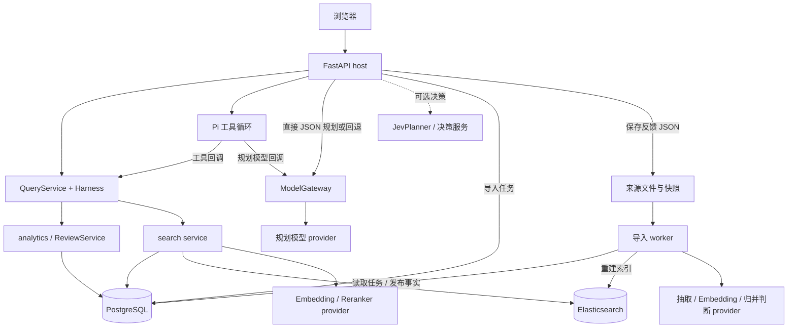

# 系统架构：当前工作区

本页描述已核验的源码与默认配置，不证明线上正在运行同一版本。
查询的状态继承、工具执行与恢复细节见 [查询数据流](query-flow.md)。
返回 [知识库入口](../README.md)。

## 组件与职责

| 组件 | 负责什么 | 入口或核心符号 |
| --- | --- | --- |
| 浏览器工作区 | 查询、题库、来源、复习、反馈和执行过程展示 | [app.js](../../src/interview_intelligence/web/assets/app.js) 的 `agentQuery` |
| FastAPI host | 认证、租户选择、查询生命周期、工具和内部模型网关 | [api.py](../../src/interview_intelligence/api.py) 的 `create_app`、`execute_query` |
| QueryService / Harness | 计划校验、scope、能力控制、SQL/检索分发与会话提交 | [query_service.py](../../src/interview_intelligence/agent/query_service.py)、[harness.py](../../src/interview_intelligence/agent/harness.py) |
| Pi Node 服务 | 受限工具循环；模型和领域工具均回调 host | [runtime.mjs](../../services/pi-agent/runtime.mjs) 的 `runQuery` |
| analytics | 生效语料范围、精确计数、排序、签名分页、详情 | [listing.py](../../src/interview_intelligence/analytics/listing.py) 的 `list_questions` |
| search | SQL eligibility、ES 召回、相关性核验、来源补全 | [service.py](../../src/interview_intelligence/search/service.py) 的 `search_questions` |
| 导入 worker | 消费 PG 导入任务，抽取、归并、发布和同步索引 | [worker.py](../../src/interview_intelligence/worker.py) 的 `process_queued_run` |
| PostgreSQL | 事实、版本、任务、会话、事件、复习和使用记录 | [models.py](../../src/interview_intelligence/domain/models.py) |
| Elasticsearch | 可重建的候选检索索引 | [elasticsearch.py](../../src/interview_intelligence/search/elasticsearch.py) 的 `retrieve`、`rebuild_index` |
| 本地文件 | 语料快照、抽取缓存、反馈和评测产物 | [web.py](../../src/interview_intelligence/web.py) 的 `save_feedback` |

## 组件关系

图中的 provider 表示调用职责，可能使用同一供应商或模型，也可能分别配置。
只有 Pi 的规划模型请求回调 `ModelGateway`；检索和导入模型客户端不经 Pi 网关。

## 启动方式决定执行路径

| 模式 | 源码中的选择 | 对调用者的含义 |
| --- | --- | --- |
| 直接 `Settings` 默认值 | `query_router_enabled=false`、`pi_agent_enabled=false`、`multi_tenant_enabled=false` | `/api/agent/chat` 可走旧 `AgentService`；新查询端点仍使用 QueryService，通常直接 JSON 规划 |
| 默认 Compose | router/Pi 默认 true，Jev/多租户默认 false | 自然语言查询通常由 Pi 编排；环境覆盖可以改变行为 |
| 结构化列表 | `StructuredQueryRequest` | host 直接执行 LIST，不进入规划模型；仍记录会话与回执 |
| Legacy chat | 非多租户、router 关闭且没有注入 planner | `AgentService.chat` 的规则路由；不具备新链路的完整回执重放 |
| Legacy search | `/api/questions/search` | 直接检索与独立降级逻辑，不等同于 QueryService 的 SEARCH 成功契约 |
| 可选 Jev | 开关开启且有配置；查询时排除多租户模式 | shadow 记录候选计划后继续规划；active 仅采用受支持且通过检查的计划 |
| 测试/集成注入 | `create_app(..., query_planner=...)` | 可注入确定性规划器；不要把此路径当作生产默认 |

配置依据：[Settings](../../src/interview_intelligence/config.py)、[compose.yaml](../../compose.yaml)。
路由依据：`api.py::execute_query`、`api.py::agent_chat`、[JevPlanner](../../src/interview_intelligence/agent/jev.py)。

“SQL 工具执行无需模型”不表示“自然语言 SQL 查询无需模型”。
自然语言 LIST/COUNT/STATS 通常仍需规划；结构化列表和同请求的成功回执重放可跳过规划。
`semantic_task=ALGORITHM_PROBLEM` 读取已有的完整语义审计范围，不在该 SQL 请求中临时完成审计。

## 模型调用和租户边界

`api.py::create_app` 装配 `ModelGateway`、retriever、查询服务和访问服务。
`ModelGateway.complete` 由 host 选择 endpoint、模型、限额；Pi 只持有内部调用 token。
Embedding、reranker 和导入 provider 有各自客户端，并接入相应预算、调用 gate 与调用记录。
因此变更模型协议时，应先辨认规划、检索、抽取、归并或 Jev 哪条调用路径受影响。

多租户启用时：

- `ScopedService` 按账号提供 QueryService、会话历史等服务。
- `tenant_service.admit` 选择本次系统或个人 provider，并处理准入。
- [TenantRetriever.selected](../../src/interview_intelligence/tenant_retriever.py) 复用语料 encoder、ES client 和索引，按账号选择 reranker。
- 查询、复习、偏好和反馈按用户隔离；共享语料并不会随账号复制一套。
- Pi callback 的账号从 host 中现有 run 恢复，不接受浏览器传入的租户身份作为该回调的依据。

## 数据权威与发布边界

| 数据 | 权威存储与生效条件 | 不应误读成 |
| --- | --- | --- |
| 原文和抽取来源 | `SourceDocument → SourceRevision → DocumentBuild`，关联快照与 source spans | ES 中的文本就是完整原文证据 |
| 当前统计事实 | active build、`INCLUDED`、`analytics_eligible` 的 occurrence/interview | 所有历史 build 都参与当前频次 |
| 标准题 | `CanonicalQuestion` 身份；展示分类可由当前证据重新汇总 | canonical 展示分类等于每条 occurrence 的筛选分类 |
| 搜索结果 | SQL eligibility + ES 候选 + SQL 事实回填；核验状态显式返回 | 候选排序可以代替完整语料统计 |
| 会话和运行 | PG conversation/turn/event/tool invocation | 活跃执行对象可以跨进程直接共享 |
| 纠正记忆 | 反馈 JSON 为来源；PG `UserPreference` 控制启用和版本 | 无条件的语义向量长期记忆 |

发布入口是 [corpus.py::publish_build](../../src/interview_intelligence/repository/corpus.py)。
它切换 active build、推进 corpus revision 并生成索引同步任务；索引构建另行执行。
SEARCH 要求 `current_revision == indexed_revision` 且已有索引；SQL 查询不以 ES 就绪为前提。
计数/列表的共同生效范围来自 [stats.py::_active_from / _conditions](../../src/interview_intelligence/analytics/stats.py)。

## 运维与执行限制

默认 Compose 分开启动 API、Pi、worker、PostgreSQL 和 Elasticsearch。
导入 worker 在 PostgreSQL 上持有单 worker advisory lock，再恢复和消费导入任务。
查询后台任务没有进入这个导入队列：`api.py::live_tasks` 与 `QueryService.runs` 属于 API 进程。
PG journal 可以保存结果、工具意图和恢复依据，但 Pi 回调仍要命中持有该 run 的进程。
多 worker/副本需要另行核验执行所有权路由；不能从“已持久化”推导出任意节点接管。
单轮 deadline、模型调用预算、工具调用预算与 provider retry 是不同限制，修改时要分别检查。

当前维护热点是 `api.py` 的装配/编排集中，以及 `query_service.py` 的状态/规则集中。
Python 与 JS 各有工具映射及证据投影；改契约时同时检查 `query_contract.py`、`harness.py` 和 Pi runtime。
旧 stats 与新 listing 仍分别实现排名计算；调整 importance/gap 公式要检查两条入口。

## 验证入口

以下是相关测试位置，不表示本次文档核验重新运行了它们。

- [test_query_agent.py](../../tests/integration/test_query_agent.py)：共享 host 状态、结构化列表、幂等回执与签名分页。
- [test_tenants.py](../../tests/integration/test_tenants.py)：账号隔离、准入和 provider 路由。
- [pi-runtime.test.mjs](../../tests/node/pi-runtime.test.mjs)：固定 Pi 的工具 schema、循环与 host 回调边界。
- [test_ingestion_lifecycle.py](../../tests/integration/test_ingestion_lifecycle.py)：导入生命周期。
- [test_harness.py](../../tests/unit/test_harness.py)：上下文投影、当前请求授权与工具能力。

更新本页的触发条件：启动默认值、组件职责、provider 路径、租户隔离或存储权威发生变化。
