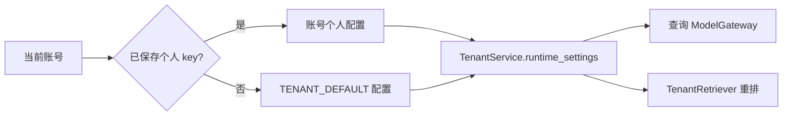

# 运行配置与提示词版本

[返回知识库入口](../README.md)

本页说明当前工作区如何选择配置、模型和提示词；`verified_at` 表示源码核对日期。
部署机实际环境、已安装包和账号配置需要另查对应回执，不能由本页默认值推定。
本次未读取 `.env`、个人模型配置或私有语料，未连接服务、调用模型。

完整运行只推荐 [普通 Compose](../development.md#推荐完整运行普通-compose)，Windows 经 WSL 启动。本页同时登记其他入口的实际行为，供模块调试、兼容和历史复现核对；这些入口不是并列的完整运行推荐。能力及验收结论统一见 [当前状态](../status/current.md)，候选实验入口统一见 [评测手册](../../eval/README.md#入口分类通用评测候选实验与历史复现)。

## 先确定配置入口

| 入口 | 配置来源 | 阅读位置 |
| --- | --- | --- |
| 直接 `Settings(...)` | 显式构造参数、进程环境、字段默认值；类本身未配置 dotenv 文件 | [Settings](../../src/interview_intelligence/config.py) |
| `load_settings()` | 调用 `Settings(_env_file=".env")`，增加当前工作目录的 dotenv 来源 | [load_settings](../../src/interview_intelligence/config.py) |
| `create_app(settings=...)` | 已提供的 Settings 对象；不再次调用 `load_settings()` | [create_app](../../src/interview_intelligence/api.py) |
| API 默认启动、worker、分类 CLI | 各自入口调用 `load_settings()` | [worker](../../src/interview_intelligence/worker.py)、[CLI](../../src/interview_intelligence/cli.py) |
| 普通 Compose（推荐完整运行） | YAML 的 `environment` 显式注入容器环境 | [compose.yaml](../../compose.yaml) |
| 隔离评测 Compose（采集 / 复现） | `env_file: .env` 加 `environment` 的明确覆盖 | [compose.evaluation.yaml](../../compose.evaluation.yaml) |

在本仓库未定制配置来源顺序的前提下，显式 Settings 字段参数优先于进程环境，
进程环境优先于 `_env_file` 内容，最后使用类字段默认值。
直接构造 `Settings()` 仍会读进程环境，不能把它当作完全隔离的常量对象。
相对 `.env`、数据库和语料路径受进程工作目录影响。

普通 Compose 的宿主 `.env` 用于 `${NAME:-fallback}` 插值，
它不等于把该文件所有字段自动传给容器。普通 API/worker 没有 `env_file` 条目，
也没有挂载根 `.env`；应逐项检查 `environment`，不要只检查宿主文件中是否存在变量。
例如 `EXTRACTION_PROMPT_VERSION`、`EXTRACTION_THINKING_MODE` 未在普通 Compose 中透传。
评测 Compose 显式使用 `env_file`，并把 Pi、路由、账号和标签政策改为评测配置。

## 数据、模型与调用预算

以下均为源码默认或 Compose 明示值，未知的实际部署覆盖不在本表范围内。

| 项目 | `Settings` 默认 | 普通 Compose 的差异或用途 |
| --- | --- | --- |
| 事实库 | `sqlite:///./data/interview_intelligence.db` | API/worker 使用 PostgreSQL 服务 |
| 搜索库 | `elasticsearch_url=None` | 使用 Elasticsearch 服务 |
| 语料 / 快照 | `./md` / `data/snapshots` | `/corpus` 只读挂载 / `/app/data/snapshots` |
| 生成模型 | 抽取、Judge、重排均 `ark-code-latest` | 可通过各自变量覆盖 |
| 查询模型 | `query_model=None` | API 明示回退值 `ark-code-latest` |
| 向量模型 / 维度 | `doubao-embedding-vision` / `1024` | API/worker 分别注入 |
| 提供方 endpoint / key | 均 `None` | 从明确变量注入；空值不代表可调用 |
| 总调用 / token 配额 | `max_model_calls=None` / `max_model_tokens=None` | 插值默认 `0`，不代表无限额 |
| 单次提供方超时 | `180` 秒 | 可覆盖；查询还受整轮剩余时间约束 |
| 模型间隔 | 前次调用结束后 `2` 秒 | API/worker 需使用同一锁文件 |
| 模型锁路径 | `data/model-call.lock` | 共享卷中的 `/app/runtime/model-call.lock` |

`validate_model_preflight` 要求 API key、正数维度和正数调用/token 配额。
`build_worker_services` 还检查 endpoint 和所需模型是否齐全。
因此未设置配额的 Compose 配置不会自动取得无限制模型调用能力。
向量 adapter 按模型名选择：`doubao-embedding-vision` 使用 `ArkMultimodalEncoder`，
其余走 `OpenAICompatibleEncoder`；同时核对已有索引维度和模型身份。

预算有不同层次，不能把几个数字相加或互相替换：

- [CallBudget](../../src/interview_intelligence/providers/budget.py) 约束构造它的工作单元；worker 重启时从该 run 的回执恢复使用量。
- [ModelGateway.complete](../../src/interview_intelligence/agent/model_gateway.py) 的规划次数默认最多 `4`，来自 `QUERY_MAX_MODEL_CALLS`。
- [RequestLimits](../../src/interview_intelligence/providers/runtime.py) 的整轮模型调用默认最多 `6`，共享给规划、embedding、重排等阶段。
- API 注入整轮 `180` 秒、`96000` tokens；当前 Settings 允许上限分别为 `180` 秒、`128000` tokens，规划次数上限为 `6`。
- QueryService 的领域工具预算为 `8`；工具次数与模型调用次数是不同计数。

直接构造 `QueryService` 的历史默认是 `90` 秒 / `65536` tokens，
常规 API 会以 Settings 中的 `180` 秒 / `96000` 覆盖；读测试时要检查构造参数。
查询 token 会先预留再结算，未知 usage 保守扣计，不当作零；这不是供应商账单。
[ModelCallGate](../../src/interview_intelligence/providers/gate.py) 负责跨协作进程的文件锁与间隔，
相同变量名称但不同文件系统上的锁不能提供共享串行保证。

## Pi、查询策略和账号模型

推荐的普通 Compose 把 API 的 `query_router_enabled`、`pi_agent_enabled` 默认设为 `true`；
直接构造 `Settings` 的两项默认仍为 `false`，用于理解模块直启和兼容路径，本文档整理不修改这些行为。
查询默认启用紧凑上下文与动态工具，任务标签政策默认 `VERIFIED`；
评测 Compose 明确改为 `KNOWN`，不能把后者当成人工核验状态。
Jev/Fast Decision 默认关闭，模式默认 `shadow`；模型文件或代码存在不证明它在接管查询。

[Pi runtime](../../services/pi-agent/runtime.mjs) 通过主机内部接口请求模型与工具，
普通 Compose 只给 sidecar 内部 token 和 `AGENT_HOST_URL`，不注入上游 API key。
模型名称、endpoint、预算由 Python gateway 选择，Pi 输入不能直接覆盖这些值。
内部认证配置见 [开发说明](../development.md)，部署入口见 [SSH 部署](../deployment-ssh.md)。

多账号模式默认关闭；启用后，查询/重排的提供方选择如下：

[TenantService.provider_values / runtime_settings](../../src/interview_intelligence/tenant.py)
把所选 endpoint、key、query/judge/reranker model 投影到本次运行的 Settings 副本。
个人重排模型未设置时沿用个人查询模型，系统重排模型未设置时沿用系统查询模型。
这里的系统配置是 `TENANT_DEFAULT_*`，不是全局 `MODEL_*` 的隐式付费回退。
默认试用上限 `10` 约束系统提供方请求；幂等、额度与具体 admission 语义见 [账号说明](../tenants.md)。
[TenantRetriever.selected](../../src/interview_intelligence/tenant_retriever.py) 复用基础 encoder 与搜索索引，
替换当前账号的 reranker；个人查询配置不会自动重建向量或切换导入 worker。
个人提供方失败不会自动转给全局模型，相关隔离断言见 `test_tenants.py`。

## 提示词选择与版本身份

| 用途 | 当前默认 | 受支持 / 选中机制 | 权威入口 |
| --- | --- | --- | --- |
| 抽取 | `extract_question_v2` | Settings 接受 v2–v6；worker 按该字段构造 prompt 路径 | [config](../../src/interview_intelligence/config.py)、[worker](../../src/interview_intelligence/worker.py) |
| 查询 | `query_agent_v13` | Settings 接受 v6–v13；API/gateway 按字段加载 | [model_gateway](../../src/interview_intelligence/agent/model_gateway.py) |
| 任务分类 | `task_annotation_v4` | `annotate_tasks` / CLI 默认 v4，模型路径支持 v4–v9，显式 `--prompt-version` 选择 | [task_annotation](../../src/interview_intelligence/agent/task_annotation.py)、[CLI](../../src/interview_intelligence/cli.py) |
| 去重 | `dedup_judge_v1` | worker 使用 provider 默认；评测 collector 显式支持 v1/v2/v3 | [dedup provider](../../src/interview_intelligence/dedup/provider.py)、[collector](../../eval/collect.py) |
| 旧搜索规划 | `search_plan_v1` | `SearchPlanner` 固定加载，用于对应兼容服务路径 | [SearchPlanner](../../src/interview_intelligence/agent/planner.py) |
| 重排 / 范围复核 | `rerank_v28_compact_verified_context_retry` / `scope_verify_v13_business_mechanism` | 当前源码类常量及内嵌指令 | [LLMReranker](../../src/interview_intelligence/search/reranker.py) |

旧文件仍用于历史重放和打包；文件存在、被打包或版本号最大，都不代表当前入口会选择它。
分类注入测试 classifier 时记录 `task_annotation_v1`，应与真实模型默认 v4 区分。
抽取的 `extraction_thinking_mode` 默认 `auto`；collector 可以显式覆盖提示词及 thinking 配置。
目前 worker 的 `topic_ids` 条件只包含 v4/v5，collector 包含 v4/v5/v6，
因此不能把 collector 中 v6 的实验行为直接推广到正常 worker；默认 v2 未受此差异影响。

去重需要记录两个版本：提示词文件身份和 provider 控制流身份。
v1 未开启复核时 provider 是 `dedup_judge_v6_bounded`，开启时是 `dedup_judge_v8_normalized_scope`；
v2 对应 `dedup_judge_v9_answer_boundary`，v3 对应 `dedup_judge_v10_source_evidence`，
二者开启复核时分别使用带 `verified` 的 provider 版本。
`collection_fingerprint()` 另外记录 prompt hash、guard hash、schema 和复核开关。
实际响应 `model_revision` 与请求模型别名不同，不能仅凭相同别名断言上游权重一致。

当前默认未因候选实验更换；质量与部署结论集中见 [状态表](../status/current.md#能力运行版本与验收状态)。
候选评测、历史提示词重放与来源审核从 [评测入口分类](../../eval/README.md#入口分类通用评测候选实验与历史复现) 查找，旧报告描述的是当时阶段。

## 哪些配置文件真正被读取

| 文件 | 当前核查结果 | 行为应追到哪里 |
| --- | --- | --- |
| `config/taxonomy/v1.yaml` | `load_taxonomy` 实际加载，打包进入应用资源 | [taxonomy](../../src/interview_intelligence/taxonomy/__init__.py) |
| `config/models.yaml` | 未找到运行时加载引用 | `Settings`、服务构造、tenant provider |
| `config/retrieval.yaml` | 未找到加载引用；其 HYBRID 不是 API/CLI 当前默认 HYBRID_RERANK | [SearchRequest](../../src/interview_intelligence/api.py)、[CLI](../../src/interview_intelligence/cli.py)、[retriever](../../src/interview_intelligence/search/elasticsearch.py) |
| `config/scoring.yaml` | 未找到加载引用；权重与版本由 Python / SQL 共用的 ranking 模块提供 | [ranking](../../src/interview_intelligence/analytics/ranking.py) |
| `config/pricing.yaml` | 未找到加载引用，内容也声明未验证价格 | 模型 usage 回执不能直接当货币成本 |
| `config/aliases/*.yaml` | 未找到加载引用 | 当前公司别名为 [COMPANY_ALIASES](../../src/interview_intelligence/company.py) |

“未找到引用”是本次源码搜索结论，表示这些文件不能直接作为生效配置的证据，
不是断言对应业务已经失效。修改它们之前应先确认或建立加载链路。

## 安装资源、部署与排查

[resource_path](../../src/interview_intelligence/resources.py) 优先读取包内 `resources/`，再回退源码根目录。
[pyproject.toml](../../pyproject.toml) 的 wheel `force-include` 打包所有现有提示词及 taxonomy；
[Dockerfile](../../Dockerfile) 拷贝源码后安装应用包，修改宿主 `prompts/` 不必然修改已安装资源。
评测容器另外挂载源码、配置和提示词并设置 `PYTHONPATH`；它与普通镜像路径不同。
源码默认、调用显式选项、安装资源 hash、部署回执、实际请求模型身份应分别记录。

遇到“改配置但没生效”，按以下顺序核对：

1. 确定进程入口、工作目录、实际导入包位置及 Settings 是否被显式注入。
2. 对照 Compose 的 `environment` / `env_file` 和构造参数，检查字段是否真正传入。
3. 查询账号是否选中 personal/system provider，避免把全局模型当成账号模型。
4. 核对 `resource_path` 最终路径、prompt hash、provider 版本及部署包，不用最高文件号推定。
5. 分别检查规划次数、整轮模型次数、tokens、deadline 和模型锁，避免错误归因重试。

可用的离线验证入口包括 [配置校验](../../tests/unit/test_config.py)、
[资源打包](../../tests/unit/test_packaged_resources.py)、[跨进程调用锁](../../tests/unit/test_model_call_gate.py)、
[去重 provider](../../tests/unit/test_model_dedup_provider.py)、[账号隔离](../../tests/integration/test_tenants.py)
和 [评测 collector](../../tests/integration/test_evaluation_collectors.py)。本页仅引用这些测试，本次未执行。
改动默认值、入口注入、模型选择或资源打包时同步本页；实际部署状态以对应验收证据为准。
