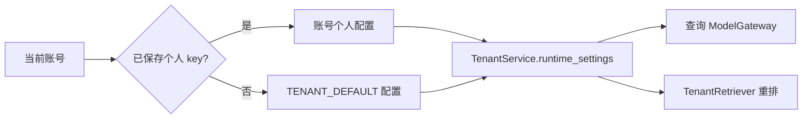

# 运行配置与提示词版本

[返回知识库入口](../README.md)

本页说明当前工作区如何选择配置、模型和提示词；`verified_at` 表示源码核对日期。
部署机实际环境、已安装包和账号配置需要另查对应回执，不能由本页默认值推定。
SSH 实际运行身份与白名单配置已另行核验，并运行了同业务包的隔离 HTTP 先导，见[本批检查点](../plans/2026-10-15-evaluation-readiness.md#第二批执行授权与检查点)；本页默认值表仍只描述源码，不据此推定部署配置。

完整运行只推荐 [普通 Compose](../development.md#推荐完整运行普通-compose)，Windows 经 WSL 启动。本页同时登记其他入口的实际行为，供模块调试、兼容和历史复现核对；这些入口不是并列的完整运行推荐。能力及验收结论统一见 [当前状态](../status/current.md)，候选实验入口统一见 [评测手册](../../eval/README.md#入口分类通用评测候选实验与历史复现)。

## 先确定配置入口

| 入口 | 配置来源 | 阅读位置 |
| --- | --- | --- |
| 直接 `Settings(...)` | 显式构造参数、进程环境、字段默认值；类本身未配置 dotenv 文件 | [Settings](../../src/interview_intelligence/config.py) |
| `load_settings()` | 调用 `Settings(_env_file=".env")`，增加当前工作目录的 dotenv 来源 | [load_settings](../../src/interview_intelligence/config.py) |
| `create_app(settings=...)` | 已提供的 Settings 对象；不再次调用 `load_settings()` | [create_app](../../src/interview_intelligence/api.py) |
| API 默认启动、worker、分类 CLI | 各自入口调用 `load_settings()` | [worker](../../src/interview_intelligence/worker.py)、[CLI](../../src/interview_intelligence/cli.py) |
| 普通 Compose（推荐完整运行） | YAML 的 `environment` 显式注入容器环境 | [compose.yaml](../../compose.yaml) |
| 隔离评测 Compose（采集 / 复现） | `env_file: .env` 加 `environment` 的明确覆盖 | [compose.evaluation.yaml](../../compose.evaluation.yaml) |
| 完整语义审核导入 | `import-semantic-scope.py` 调用 `load_settings()`，使用同一 `database_url` / `snapshot_root`；默认 dry-run，`--apply` 才写事实 | [导入脚本](../../scripts/import-semantic-scope.py) |

在本仓库未定制配置来源顺序的前提下，显式 Settings 字段参数优先于进程环境，
进程环境优先于 `_env_file` 内容，最后使用类字段默认值。
直接构造 `Settings()` 仍会读进程环境，不能把它当作完全隔离的常量对象。
相对 `.env`、数据库和语料路径受进程工作目录影响。

普通 Compose 的宿主 `.env` 用于 `${NAME:-fallback}` 插值，
它不等于把该文件所有字段自动传给容器。普通 API/worker 没有 `env_file` 条目，
也没有挂载根 `.env`；应逐项检查 `environment`，不要只检查宿主文件中是否存在变量。
例如 `EXTRACTION_PROMPT_VERSION`、`EXTRACTION_THINKING_MODE` 未在普通 Compose 中透传。
评测 Compose 显式使用 `env_file`，并把 Pi、路由、账号和标签政策改为评测配置。

## 数据、模型与调用预算

以下均为源码默认或 Compose 明示值，未知的实际部署覆盖不在本表范围内。

| 项目 | `Settings` 默认 | 普通 Compose 的差异或用途 |
| --- | --- | --- |
| 事实库 | `sqlite:///./data/interview_intelligence.db` | API/worker 使用 PostgreSQL 服务 |
| 搜索库 | `elasticsearch_url=None` | 使用 Elasticsearch 服务 |
| 语料 / 快照 | `./md` / `data/snapshots` | `/corpus` 只读挂载 / `/app/data/snapshots` |
| 生成模型 | 抽取、Judge、重排均 `ark-code-latest` | 可通过各自变量覆盖 |
| 查询模型 | `query_model=None` | API 明示回退值 `ark-code-latest` |
| 向量模型 / 维度 | `doubao-embedding-vision` / `1024` | API/worker 分别注入 |
| 提供方 endpoint / key | 均 `None` | 从明确变量注入；空值不代表可调用 |
| 总调用 / token 配额 | `max_model_calls=None` / `max_model_tokens=None` | 插值默认 `0`，不代表无限额 |
| 单次提供方超时 | `180` 秒 | 可覆盖；查询还受整轮剩余时间约束 |
| 模型间隔 | 前次调用结束后 `2` 秒 | API/worker 需使用同一锁文件 |
| 模型锁路径 | `data/model-call.lock` | 共享卷中的 `/app/runtime/model-call.lock` |

`validate_model_preflight` 要求 API key、正数维度和正数调用/token 配额。
`build_worker_services` 还检查 endpoint 和所需模型是否齐全。
因此未设置配额的 Compose 配置不会自动取得无限制模型调用能力。
向量 adapter 按模型名选择：`doubao-embedding-vision` 使用 `ArkMultimodalEncoder`，
其余走 `OpenAICompatibleEncoder`；同时核对已有索引维度和模型身份。

预算有不同层次，不能把几个数字相加或互相替换：

- [CallBudget](../../src/interview_intelligence/providers/budget.py) 约束构造它的工作单元；worker 重启时从该 run 的回执恢复使用量。
- [ModelGateway.complete](../../src/interview_intelligence/agent/model_gateway.py) 的规划/回答调用默认最多 `8`，来自 `QUERY_MAX_MODEL_CALLS`，可配置1–32。
- 查询API、公开搜索和QueryService显式向 [RequestLimits](../../src/interview_intelligence/providers/runtime.py) 注入 `QUERY_MAX_TOTAL_MODEL_CALLS`：默认 `24`，可配置1–128，共享给规划、embedding、重排等阶段。底层RequestLimits保留旧直接调用的6次默认，不能据此推导服务实际上限。
- `QUERY_DEADLINE_SECONDS` 默认 `600` 秒、可配置大于0且不超过1800秒；`QUERY_MAX_TOKENS` 默认 `256000`、可配置4096–1048576。这是整轮累计预算，不扩大单次模型上下文或输出上限。
- QueryService 的领域工具预算为 `8`；工具次数与模型调用次数是不同计数。

v16工具能力按成本准入：综合目标读取必须给后续ANSWER规划留下1次共享调用和1次规划机会；投影额外计入即将发生的当前规划，执行校验不重复扣除。provider门保护工具阶段的回答调用，成本不足时用已有有效证据回答及说明边界。BM25/DENSE/HYBRID/HYBRID_RERANK的搜索基础调用分别为0/1/1/3，可选核验不能吞掉回答预留；不提高总预算，也不把调用预留当作token或时间保证。

直接构造 `QueryService` 与Settings使用同一组复杂任务默认（8次规划、24次共享调用、600秒、256000 tokens）；测试及历史复现可显式传入原来的较低预算。Pi接收host剩余规划次数并校验0–32，服务计时上限1800秒；不再另以6次/180秒截断。
查询 token 会先预留再结算，未知 usage 保守扣计，不当作零；这不是供应商账单。
`GET /api/health` 的 `query_request_limits/search_request_limits` 回报实际配置；评测上下文从QueryService实例回报共享调用、token和时限，不再从底层默认推导。浏览器按持久run的 `lease_until` 加20秒传输余量等待（租约已包含10秒恢复余量），刷新后保留已过时间；旧回执缺租约时使用630秒兼容等待。HTTP评测客户端按服务报告时限加30秒等待。已有 `.env` 的显式旧值仍会覆盖新默认，需要按环境单独调整；历史冻结评测沿用原预算。
[ModelCallGate](../../src/interview_intelligence/providers/gate.py) 负责跨协作进程的文件锁与间隔，
相同变量名称但不同文件系统上的锁不能提供共享串行保证。
正类设计证据的可选补核验沿用这些累计预算，范围补核验剩余不足23秒时跳过；主排证据补核验还为必要的范围复核预留一次调用、完整 token 上界和20秒，最低需43秒。可分配的协作期限至多30秒，并保留父请求返回及后续必要调用的时间。子期限不会替换父取消/期限；同步传输阻塞读取仍无严格墙钟中断保证，细节见[查询数据流](../architecture/query-flow.md#search-与-sql-全集的区别)。

工作区澄清范围复用原预算和模型锁，不新增额度。仅明确业务应用目标且已选 CANDIDATES 的重排路径，同PIT读取软先验全部完整标题并核对SQL数量/ID/text hash和投影版本，以一次 `BUSINESS_CATALOG_SELECTION` 软提名替代第二次目标embedding；复用选定重排profile的client、共享gate、stream及回调，总池仍为宽10/目标新增最多40/总50。仅独立/排除要求、模型软改写和非重排路径不启用该筛选。目录过大或不可用时不能取前N或截题名；明确退回已取得的base-vector与目标词法候选，不追加隐藏模型。selector不可用的替代后端保留旧目标embedding并标明fallback。

整轮仍为6 calls / 96k / 180秒；请求预算包含完整消息、schema、原话范围和6144输出上限，逐阶段按实际usage结算后再准入。全目录单次能容纳不保证选中50题的原问主排和范围核验也能容纳，后续不足保留PENDING。`catalog_selection_audit` 私有记录prepared/body hash、完整目录身份、软提名与预算，`attempted`为进入调用分支，`provider_admitted`为共享gate后的client入口；未知usage保守收费。旧排名审计仅代表宽/目标各至多200个有界ES命中。两种审计都不进入模型或候选后页，分页只读取同一快照，不重复embedding/核验；目录曝光及紧凑wire均不证明语义gold或业务全量通过。

目标支路的 `engineering_recall_prior_v1` 复用当前SQL来源审核，不增加模型或embedding调用；只把同一occurrence筛选下工程确认及待核验来源映射为目标候选ID，宽召回仍使用原资格全集，业务归属留给后续核验。默认ES声明 `supports_target_eligibility` 并确认应用ID摘要；`target_eligibility` 记录来源审核版本/hash、语料/标注版本、数量/覆盖及requested/available/applied/fallback。无当前有效审核或替代后端不支持时明确标记宽目标fallback，支持后端丢参数或摘要不符则失败。先验不按旧题型标签筛题，也不能借用其它轮次的确认。

HTTP 评测 context 分别暴露规划上限 `query_planning_max_calls` 与整轮 `request_max_model_calls/request_max_tokens`；采集按整轮上限预留，不能使用默认 4 次规划代替默认 6 次总调用。SSH 原生路径需独立核验 API/worker 的实际锁设置、进程与同一文件设备/inode；操作见 [评测手册](../../eval/README.md#1-先验证框架)。

## Pi、查询策略和账号模型

推荐的普通 Compose 把 API 的 `query_router_enabled`、`pi_agent_enabled` 默认设为 `true`；
直接构造 `Settings` 的两项默认仍为 `false`，用于理解模块直启和兼容路径，本文档整理不修改这些行为。
查询默认启用紧凑上下文与动态工具，任务标签政策默认 `VERIFIED`；
评测 Compose 明确改为 `KNOWN`，不能把后者当成人工核验状态。
`QUERY_COLLECTION_SELECTION_THRESHOLD` / `query_collection_selection_threshold` 默认100（正整数，最多1,000,000），普通 Compose 明确透传同名变量。它控制工程 LIST 何时先报数量并让用户选分类或全量分页；依据已应用前 N / 复习条件的可见去重题数，含待核验项。阈值不限制返回总量或页数，COUNT/STATS 不触发数量菜单，选全量后的同范围分页不重复澄清。类别来自已有来源主题，分类不明和待核验另列；状态与签名边界见 [查询数据流](../architecture/query-flow.md#完整语义集合与来源审核导入)。

`relevance_scope` 是 host 从可信原话生成的每次查询状态，不是新的全局默认筛选，也不是模型可提交的自由配置。AI/Agent/MCP 默认不排除；领域排除和独立系统要求均须原话直接授权。选择候选仅改变执行方式，SEARCH/NEXT/重查继续保留该范围；存在 scope 时要求 HYBRID_RERANK，不能降级到未核验的混合/关键词结果。候选分页与 SQL 全量分页各用自己的请求种类和签名身份；阈值100不改变普通 SEARCH 的50候选上限。原话明确全量工程范围后细化业务目标的完整工集每次提供至多20题窗口，按实际预算处理前缀，不能从阈值推定业务全集已核验。

Jev/Fast Decision 默认关闭，模式默认 `shadow`；模型文件或代码存在不证明它在接管查询。

[Pi runtime](../../services/pi-agent/runtime.mjs) 通过主机内部接口请求模型与工具，
普通 Compose 只给 sidecar 内部 token 和 `AGENT_HOST_URL`，不注入上游 API key。
模型名称、endpoint、预算由 Python gateway 选择，Pi 输入不能直接覆盖这些值。
v16 API显式传 `tool_wire_version=query_step_v1`，用一份完整动作schema承载模型步骤，再由Pi分派到原领域工具；该版本减少重复工具声明，保留逐步规划及权限检查。旧提示词不传此字段，仍使用原领域工具菜单；直接JSON规划路径不受影响。`model_wire` 持久事件区分传输版本，不把prompt文件版本当作整个模型请求身份。
内部认证配置见 [开发说明](../development.md)，部署入口见 [SSH 部署](../deployment-ssh.md)。

多账号模式默认关闭；启用后，查询/重排的提供方选择如下：

[TenantService.provider_values / runtime_settings](../../src/interview_intelligence/tenant.py)
把所选 endpoint、key、query/judge/reranker model 投影到本次运行的 Settings 副本。
个人重排模型未设置时沿用个人查询模型，系统重排模型未设置时沿用系统查询模型。
这里的系统配置是 `TENANT_DEFAULT_*`，不是全局 `MODEL_*` 的隐式付费回退。
默认试用上限 `10` 约束系统提供方请求；幂等、额度与具体 admission 语义见 [账号说明](../tenants.md)。
[TenantRetriever.selected](../../src/interview_intelligence/tenant_retriever.py) 复用基础 encoder 与搜索索引，
替换当前账号的 reranker；个人查询配置不会自动重建向量或切换导入 worker。
个人提供方失败不会自动转给全局模型，相关隔离断言见 `test_tenants.py`。

## 提示词选择与版本身份

| 用途 | 当前默认 | 受支持 / 选中机制 | 权威入口 |
| --- | --- | --- | --- |
| 抽取 | `extract_question_v2` | Settings 接受 v2–v6；worker 按该字段构造 prompt 路径 | [config](../../src/interview_intelligence/config.py)、[worker](../../src/interview_intelligence/worker.py) |
| 查询 | `query_agent_v16` | Settings 接受 v6–v16，普通 Compose 回退值同为 v16，显式环境选择继续优先。v16分离用户目标、工具动作及host完成状态，综合目标可在原预算内多轮取证后ANSWER；旧提示词全部保留 | [model_gateway](../../src/interview_intelligence/agent/model_gateway.py)、[完成契约](../../src/interview_intelligence/agent/goal_contract.py) |
| 任务分类 | `task_annotation_v4` | `annotate_tasks` / CLI 默认 v4，模型路径支持 v4–v9，显式 `--prompt-version` 选择 | [task_annotation](../../src/interview_intelligence/agent/task_annotation.py)、[CLI](../../src/interview_intelligence/cli.py) |
| 去重 | `dedup_judge_v1` | worker 使用 provider 默认；评测 collector 显式支持 v1/v2/v3 | [dedup provider](../../src/interview_intelligence/dedup/provider.py)、[collector](../../eval/collect.py) |
| 旧搜索规划 | `search_plan_v1` | `SearchPlanner` 固定加载，用于对应兼容服务路径 | [SearchPlanner](../../src/interview_intelligence/agent/planner.py) |
| 重排 / 范围复核 | `rerank_v42_source_activity_reference` / `scope_verify_v25_source_activity_reference` | 当前工作区候选，范围契约为 `business_scope_v7_source_activity_reference`、独立裁决v2、candidate source v4；业务活动证据单列，当前任务/建设仍须原问，有界正式frame单独引用。完整工集以source policy v4绑定来源与实际两份scoped提示词hash；未知保留PENDING。未部署，工程与真实语义验收尚未完成，原gold及单轮预算不变 | [LLMReranker](../../src/interview_intelligence/search/reranker.py)、[业务范围契约](../../src/interview_intelligence/search/business_scope.py) |

旧文件仍用于历史重放和打包；文件存在、被打包或版本号最大，都不代表当前入口会选择它。
明确全量工程集合细化为业务候选时，20 是每次提供窗口的上限，显示页大小独立。调用前完整准备主排和必要的独立范围请求，含全部消息、schema 和两份6144输出预留，按本轮剩余调用/token预算选择最长就绪前缀；尾部保持未处理，后续 NEXT 使用新一轮原有 6 calls / 96k tokens / 180 秒预算继续。第一道也无法容纳时零模型保留待核验并推进，不能硬排或反复处理同题。`engineering_workset_adaptive_prefix_v1` 单独参与工集证明策略及缓存身份。缓存页、回执 GET 和刷新不调用模型。此路径不提高单轮预算或 6144 输出上限；普通 SEARCH 仍保留至多 50 的候选边界。容量预选不保证可选修复、传输或墙钟成功，实现、真实语义质量和部署状态分别核验。
分类注入测试 classifier 时记录 `task_annotation_v1`，应与真实模型默认 v4 区分。
抽取的 `extraction_thinking_mode` 默认 `auto`；collector 可以显式覆盖提示词及 thinking 配置。
目前 worker 的 `topic_ids` 条件只包含 v4/v5，collector 包含 v4/v5/v6，
因此不能把 collector 中 v6 的实验行为直接推广到正常 worker；默认 v2 未受此差异影响。

去重需要记录两个版本：提示词文件身份和 provider 控制流身份。
v1 未开启复核时 provider 是 `dedup_judge_v6_bounded`，开启时是 `dedup_judge_v8_normalized_scope`；
v2 对应 `dedup_judge_v9_answer_boundary`，v3 对应 `dedup_judge_v10_source_evidence`，
二者开启复核时分别使用带 `verified` 的 provider 版本。
`collection_fingerprint()` 另外记录 prompt hash、guard hash、schema 和复核开关。
实际响应 `model_revision` 与请求模型别名不同，不能仅凭相同别名断言上游权重一致。

当前工作区查询默认改为 query v16，分离目标、执行和回答完成；2026-10-25经用户授权将默认预算调为规划8次、共享24次/256k/600秒，后续步骤不重置累计用量，Pi接收host剩余调用上界。完整性/复习状态摘要有界保留，零结果可引用本轮合法工具回执作范围分析。10-19记录中的SSH服务为显式 query v15；本机部署及本次预算生效另以本地回执为准；真实两轮专项记录见[本次计划](../plans/2026-10-19-query-goal-completion.md)。重排/范围复核候选仍为 rerank v42 / scope v25，目录筛选版本为 `business_catalog_soft_selection_v1`；旧语义gold未通过，新完整工集和来源证明路径不能从离线契约推定模型质量。10-16 SSH发布的工程全集/分类选择仍为阈值100、rerank v15 / scope v6、r295/i295/a32，其他模型/锁/预算未改。320道SQL工程全集与普通SEARCH至多50候选分页相互独立，实际版本与证据见[SSH发布](../deployment-ssh.md#当前发布版本)及[状态证据](../status/current.md#按问题查看证据)。
候选评测、历史提示词重放与来源审核从 [评测入口分类](../../eval/README.md#入口分类通用评测候选实验与历史复现) 查找，旧报告描述的是当时阶段。

## 哪些配置文件真正被读取

| 文件 | 当前核查结果 | 行为应追到哪里 |
| --- | --- | --- |
| `config/taxonomy/v1.yaml` | `load_taxonomy` 实际加载，打包进入应用资源 | [taxonomy](../../src/interview_intelligence/taxonomy/__init__.py) |
| `config/models.yaml` | 未找到运行时加载引用 | `Settings`、服务构造、tenant provider |
| `config/retrieval.yaml` | 未找到加载引用；其 HYBRID 不是 API/CLI 当前默认 HYBRID_RERANK | [SearchRequest](../../src/interview_intelligence/api.py)、[CLI](../../src/interview_intelligence/cli.py)、[retriever](../../src/interview_intelligence/search/elasticsearch.py) |
| `config/scoring.yaml` | 未找到加载引用；权重与版本由 Python / SQL 共用的 ranking 模块提供 | [ranking](../../src/interview_intelligence/analytics/ranking.py) |
| `config/pricing.yaml` | 未找到加载引用，内容也声明未验证价格 | 模型 usage 回执不能直接当货币成本 |
| `config/aliases/*.yaml` | 未找到加载引用 | 当前公司别名为 [COMPANY_ALIASES](../../src/interview_intelligence/company.py) |

“未找到引用”是本次源码搜索结论，表示这些文件不能直接作为生效配置的证据，
不是断言对应业务已经失效。修改它们之前应先确认或建立加载链路。

## 安装资源、部署与排查

外部 agent 的可选 stdio 入口 `ii-mcp` 不读取 `.env` 或创建模型客户端；其 `INTERVIEW_API_BASE_URL`、固定租户会话、evaluation 用途、管线白名单与等待上限见[只读 MCP 配置](../mcp.md#安装和启动)。搜索默认 BM25，与 REST API 默认 HYBRID_RERANK 分别声明。

[resource_path](../../src/interview_intelligence/resources.py) 优先读取包内 `resources/`，再回退源码根目录。
[pyproject.toml](../../pyproject.toml) 的 wheel `force-include` 打包所有现有提示词及 taxonomy；
[Dockerfile](../../Dockerfile) 拷贝源码后安装应用包，修改宿主 `prompts/` 不必然修改已安装资源。
评测容器另外挂载源码、配置和提示词并设置 `PYTHONPATH`；它与普通镜像路径不同。
源码默认、调用显式选项、安装资源 hash、部署回执、实际请求模型身份应分别记录。

遇到“改配置但没生效”，按以下顺序核对：

1. 确定进程入口、工作目录、实际导入包位置及 Settings 是否被显式注入。
2. 对照 Compose 的 `environment` / `env_file` 和构造参数，检查字段是否真正传入。
3. 查询账号是否选中 personal/system provider，避免把全局模型当成账号模型。
4. 核对 `resource_path` 最终路径、prompt hash、provider 版本及部署包，不用最高文件号推定。
5. 分别检查规划次数、整轮模型次数、tokens、deadline 和模型锁，避免错误归因重试。

可用的离线验证入口包括 [配置校验](../../tests/unit/test_config.py)、
[资源打包](../../tests/unit/test_packaged_resources.py)、[跨进程调用锁](../../tests/unit/test_model_call_gate.py)、
[去重 provider](../../tests/unit/test_model_dedup_provider.py)、[账号隔离](../../tests/integration/test_tenants.py)
和 [评测 collector](../../tests/integration/test_evaluation_collectors.py)。这里维护测试入口，本轮实际命令、结果及跳过项见 [收口验收](../verification/2026-10-15-project-consolidation.md)。
改动默认值、入口注入、模型选择或资源打包时同步本页；实际部署状态以对应验收证据为准。
