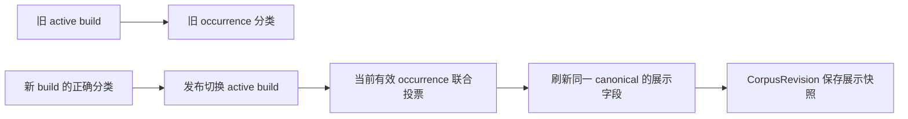

# PIT-007：来源标签修好了，标准题为什么还显示旧分类

[返回索引](README.md) · [数据模型](../architecture/data-model.md)

## 30 秒回忆

- 根因：去重复用了稳定 canonical ID，发布切了来源构建，却未刷新 canonical 的展示分类。
- 修法：在发布事务内按当前有效 occurrence 的联合分类投票刷新，发布失败则一起回滚，并保存版本快照。
- `resolved` 只覆盖这个展示投影缺口；不代表源标签、语义归并或当前线上所有数据都已正确。

## 合并记录清单与分界

原始证据保留在[问题日志](../../md/issue.md)；下列原编号、标题和时间可用于反查。

| 原记录 | 与本次根因的关系 |
| --- | --- |
| #38「来源分类修复后标准题仍展示旧标签」 | 本篇主事故：源 occurrence 已纠正，复用 canonical 仍保留首次分类 |
| #33「AI 领域被误当成提问类型」及 2026-10-01 18:24 分类维护 | 上游修正背景；模型任务判断错误本身归 PIT-006 |
| #36「开发检查器漏掉原始题目中的空格」 | 同一维护过程的独立误诊：错误检查锚点让成功流水线看起来失败 |
| 2026-10-01 18:50 已发布标签核验 | 列表、详情与来源对照的历史运行证据，不是本次新验收 |
| [展示分类决策](../decisions/2026-10-01-canonical-display-classification.md) | 当前有效证据、联合投票、平票与事务规则 |
| [导入核验报告](../verification/2026-10-01-import-rag-smoke.md)的 18:24 / 18:50 补充 | 八项来源对照通过后仍需展示检查，及后续真实页面结果 |

不重复整理全部来源类型错误，见 [PIT-006](2026-10-15-source-eligibility-policy.md)；错误归并不是换展示标签能修复，见 [PIT-003](2026-10-15-dedup-overmerge.md)。
旧搜索和后续详情遇到不同 corpus revision 的跨时读取（原 #37），不能仅凭两个截图不同就归入本缺陷。
#36 检查器误写和 #37 跨版本比较的主复盘见 [PIT-017](2026-10-06-evaluation-reference-drift.md)；本篇仅保留 #36 在本次维护时间线中的误诊支线。

## 触发与影响

修正来源后，八项 occurrence 分类对照已通过，但用户的标准题列表和详情还显示旧的 AI 标签。
当时维护操作复用正常抽取、去重、发布和索引，`SAME` 归并保持原 canonical 身份。
首次创建时写入的 canonical 分类没有随当前来源替换刷新，导致“事实层已更新、展示投影没更新”。
仅验证来源标签会漏掉这个问题；重复抽取同一来源，也不能自动补上缺失的发布逻辑。

旧 occurrence 保留用于历史追溯，但不能参加新展示值的当前证据投票。

## 已证实原因与不能推断的事

- 已证实：发布只切来源、canonical 保留首次分类；此前测试只看 occurrence，遗漏了实际展示读取字段。
- 已证实：同一 canonical 可以有不同来源问法和分类；字段不一致不是天然错误，不能批量把全部差异清零。
- 需要核查：投票规则是否被调用、active build 是否正确、每票是否来自当前有效事实，以及前端显示的是哪个版本。
- 不能推断：最大票分类必然语义正确；如果当前事实本身标错，投影一致也会显示错误标签。
- 不能推断：一次局部页面验收已覆盖所有旧构建、所有归并或任何后来的部署环境。

## 实际处理时间线与误诊支线

| 阶段 | 实际发生与处理 | 保留的边界 |
| --- | --- | --- |
| 上游来源维护 | 补任务类型优先级，重跑三篇来源，八项来源对照通过 | 这只证明被查来源；还没查 canonical 展示 |
| #36 检查器失败 | 算法题锚点漏空格，维护报告失败；只读不可变来源后修检查锚点，原失败报告保留 | 没有改原文、标签或重跑模型；检查器错不等于管线错 |
| #36 后续定位 | 终点烟测改为从来源任务锚点找当前 canonical，避免硬编码旧 UUID | 仍检查缺失、重复和错误合并；不是任意模糊匹配放行 |
| #38 定位真实缺陷 | 来源正确但标准题仍显示旧分类，确认发布未同步展示字段 | 不能用前一次“测试锚点错”解释后来真实数据差异 |
| 修复前验证 | 五个发布/回滚用例先复现失败 | 保留 before 证据，不能只写修复后绿色结果 |
| 修复及历史验证 | 加联合分类投票；当时相关 39 项、完整 221 项通过，另 1 项跳过 | 是当次工程报告，未关闭语义金标门槛 |
| 2026-10-01 18:50 | 当时 v71 列表与详情展示正确，三个设计/故障案例做来源核对 | 全量导入仍在进行，旧标签维护和范围误合并仍另有剩余 |

## 当前修复规则

[refresh_canonical_classifications](../../src/interview_intelligence/repository/corpus.py) 只从满足以下条件的 occurrence 统计票数：

1. 所属构建等于来源当前 `active_build_id`。
2. 构建 `decision == INCLUDED`，面试 `analytics_eligible == True`。
3. occurrence 已关联 canonical；按 `(topic_id, question_type, taxonomy_version)` 联合分组。

选最高频的真实联合分类；并列时若原展示值仍在最高票中则保留，否则使用稳定排序。
不能分别选 topic 与 type 的众数后拼接，因为所得组合可能从未被任何来源支持。
过期、未发布、排除和非事实行均不参与；这也是为什么查询所有历史 occurrence 再投票会复发。

`publish_build` 先切 active build，再调用刷新；两者在同一个文档数据库事务内，失败一起回滚。
`CorpusRevision.canonical_snapshot` 保存展示字段，并记录 `publication_v2_active_classification`。
这个修复不改 canonical ID、文本、来源问法、归并判断或复习记录，也不把展示分类变成每次出现的事实分类。
没有必要仅为刷新投影再次调用模型；源标签是否需要重处理是另一项判断。

## 已存在与待补的防复发措施

已存在：当前证据范围、联合组合、平票稳定、发布事务回滚和快照，都有明确源码及定向测试。
已存在：检查任务应分别比较 occurrence、canonical、版本快照及真实页面，不能拿其中一层代替全部。
待持续执行：分类政策改变时，先核对来源事实的语义，再检查当前投票及展示；复盘状态只关闭本篇限定的投影机制。
待扩大验证：新的发布路径若绕过 `publish_build`，应证明仍保持同一不变量；不能因函数存在便假定所有未来调用都会使用它。
该实现会保留没有当前有效投票的 canonical 原展示值；它不是“清理所有历史标准题”的工具，有效查询范围仍须由事实条件控制。

再遇到类似问题，先固定 corpus revision，定位当前来源构建及 canonical，再查投票输入和发布路径，最后比对页面。
若来源标签就错，回到 PIT-006；若 identity 归并错，回到 PIT-003；不要用改展示分类掩盖它们。

## 测试入口与自测

主要回归在 [test_canonical_metadata_publication.py](../../tests/integration/test_canonical_metadata_publication.py)：

- 正确来源发布后刷新展示和快照，同时保持身份。
- 被替换来源的旧票不能压过当前来源。
- 联合分类必须实际被观察到，平票行为稳定。
- 未发布、排除和不符合事实资格的数据不参与。
- 发布失败时展示字段与来源激活一起回滚。

相关生命周期见 [test_corpus_snapshots.py](../../tests/integration/test_corpus_snapshots.py) 和 [test_ingestion_lifecycle.py](../../tests/integration/test_ingestion_lifecycle.py)。
本次只做静态复核，未运行测试或访问线上；`resolved` 沿用当次修复、验收与现有实现，范围不扩展到整体标签质量。

1. 来源分类已经正确、canonical 仍旧，为什么重复调用模型可能无效？要点：缺的是发布投影刷新，复用 identity 会继续保留旧展示。
2. 为什么不能分别给 topic 和 type 取众数？要点：可能拼出无来源支持的组合；应按真实联合分类投票，并排除旧构建。
