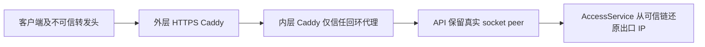

# PIT-021：两层代理把真实来源 IP 变成回环地址

[返回踩坑索引](README.md) · [访问管理验收](../verification/2026-10-09-access-panel.md)

## 30 秒回忆

- 已发现：正式两层 Caddy 的原配置把来源 IP 识别成回环地址；代理 socket 地址不能直接当作真实访客出口。
- 修复：外层不采信客户端伪造转发头，内层只信任回环代理，API 保留真实 socket peer，由应用解释可信链。
- `resolved` 限于报告中的双代理来源链；本次没有重新检查线上配置，也没有证据证明当时已经发生大规模误限额。

## 来源与触发场景

主证据是[验收报告](../verification/2026-10-09-access-panel.md)“验收中发现并修复”第 1 项，以及“发布与证据”中的正式 HTTPS 来源验证。
[公开证据索引](../verification/2026-10-09-access-panel.evidence.json)保留 `client_ip_global`、`forged_forwarding_headers_ignored` 和隔离代理证明产物的 hash。
原始代理证明与运行回执仍在报告引用的私有产物目录；本篇不复制实际访客地址、配置凭据或原始请求。

该图描述报告中的部署拓扑；应用经过其他代理、容器网络或负载均衡时，不能照抄回环地址范围而不重新验证。

## 已发生的错误与潜在影响

| 类别 | 可以确认的结论 |
| --- | --- |
| 实际发现 | 两层 Caddy 原配置让来源 IP 变成回环地址，来源身份归因错误 |
| 源码可证的依赖 | 访客观察、IP 封禁、IP 配额和分钟限流使用识别后的 IP |
| 潜在业务影响 | 若多人被错误归为同一 IP，开启相应策略后可能共享额度、互相触发限流或受同一 IP 封禁影响 |
| 未获证明 | 报告没有给出该配置已经造成大规模误封或误限额的真实事件、人数和持续时间 |
| 当时上线条件 | 正式核验时对话额度与 IP 限流开关均关闭；预置阈值存在不等于策略已经生效 |

真实同出口的多设备共享 IP 是网络事实，与“所有来源都误成代理回环”不同；修代理链不会让 NAT 出口变成自然人身份。
设备签名 Cookie 与网络出口 IP 是不同主体，本篇不把来源链修复扩展为设备唯一性或账号身份保证。

## 根因、处理顺序与证据不足处

| 阶段 | 有记录的处理 | 判断边界 |
| --- | --- | --- |
| 验收发现 | 识别两层 Caddy 原配置的回环来源问题 | 不能只看服务 200 或代理能连通就确认来源身份正确 |
| 隔离验证 | 用隔离双代理验证内层严格信任回环、外层去伪造头的方案 | 不是只在 TestClient 中替换一个 header 的验证 |
| 应用边界 | 关闭 Uvicorn 自动代理头解析，由应用从真实 socket peer 判断信任链 | 避免应用在判断可信邻居前丢失直接连接身份 |
| 正式发布 | 报告记载 2026-10-09 12:46 发布，12:48 完成公网 HTTPS 核验 | 当时仅重启 API 和专用内层 Caddy，不能推断本次仍是该配置 |
| 结果核对 | 正式 HTTP 检查覆盖真实公网来源及伪造代理头拒绝 | 正式浏览器点击未执行；浏览器交互与截图来自隔离服务 |

现有报告没有列出所有中间代理配置、逐次失败候选或完整试错顺序；这些部分未知，不补写“先信任全部地址再回退”等故事。
隔离代理证明和正式 HTTPS 通过是两层证据，应用单元/集成测试又是第三层，不能彼此替代。

## 当前源码中的 header 信任规则

[AccessService.client_ip](../../src/interview_intelligence/access.py) 的起点是 `request.client.host`，不是 `X-Forwarded-For` 最左端。

1. 直接 socket peer 不在 `trusted_proxy_cidrs` 时，不使用它携带的转发链，返回该 peer。
2. 直接 peer 可信时，解析 `X-Forwarded-For`，从右向左逐跳前进。
3. 到第一个不可信地址即停止；它左边可能是访客伪造值，不能继续挑一个更像公网的地址。
4. 当前实现对超过 32 项的链或遍历到的非法 IP 返回 `unknown`，不随意选一个地址顶替。
5. `secure` 只接受实际 HTTPS，或可信直接 peer 提供的 `X-Forwarded-Proto: https`；不可信客户端不能仅靠该头改变判断。

这套应用规则依赖代理正确维护链：应用知道可信邻居，不意味着能判断被可信代理错误保留的任意客户端头。
因此报告中的外层去伪造头、内层严格信任与应用检查是一套配合关系，不能只改其中一处就宣布完成。

## 已有防复发措施与部署复核项

- [部署说明](../deployment-ssh.md)限定报告拓扑的应用信任范围为 `127.0.0.1/32,::1/128`，不能扩大成所有地址或整个私网。
- [服务部署脚本](../../scripts/deploy-ssh-services.py)仅在有公网域名的双代理模式下设置内层 `trusted_proxies static` 和 `trusted_proxies_strict`。
- 同一说明保留外层不信任外来转发头的行为；没有公网域名时，内层不应信任来访客户端的转发头。
- [Compose 启动命令](../../compose.yaml)和 SSH API 单元使用 `--no-proxy-headers`，让应用读取真实 socket peer。
- [代理链测试](../../tests/integration/test_access.py)覆盖不可信 peer 的伪造头被忽略、可信链从右侧停在首个不可信地址，以及可信 HTTPS 的 Secure Cookie。

测试中的 `10.0.0.0/8` 是人为构造的信任网段，用于模拟多跳，不是本项目正式部署的推荐配置。
部署复核仍需检查实际 API 启动参数、内外代理配置和直接连接地址；源码里有正确默认或模板不证明运行进程已采用。
变更拓扑后应复验普通来源与伪造头两类请求，再看真实访问记录；不能仅用正常请求“显示了一个公网 IP”证明抗伪造成立。
本次未读取运行环境或执行探针，也不假定历史转发头问题已造成的旧统计会被自动修正。

## 验证范围与自测

本篇沿用当次隔离双代理与正式 HTTPS 报告，并静态核对当前 `AccessService` 和部署入口。
`runtime_verified=false` 表示本次没有访问服务、运行代理或重新执行 [test_access.py](../../tests/integration/test_access.py)。
此前完整测试数量属于访问管理整体验收，不能全部算作代理链专项覆盖；本篇不扩展为泛安全审计结论。

1. 可信代理送来多个 X-Forwarded-For 地址，为什么不能直接拿最左端？要点：应从真实 peer 向左验证可信链，首个不可信 hop 左侧可能来自访客伪造。
2. 来源曾误成同一回环 IP，能否直接写“所有用户因此被限额”？要点：不能；须证明策略启用及实际拒绝事件，报告当时正式额度/限流开关关闭。
