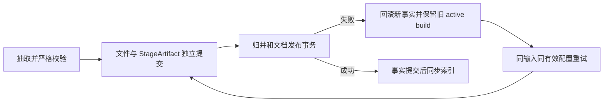

# PIT-005：抽取成果、发布事实和运行状态不能共用一个成功标记

[返回索引](README.md) · [入库流程](../architecture/ingestion-flow.md)

## 30 秒回忆

- 下游归并失败曾回滚已付费的抽取，重试又从头调用；有效阶段产物应在文档发布事务之前独立提交。
- 已有生效版本、当前更新任务、历史失败是三个维度；新任务排队不能让旧事实在界面消失。
- 缓存和批次恢复已缓解重复成本；单文档 `retry-failed` 空路径缺口仍存在，运行中也不证明进程有进展。

## 合并记录与边界

全部原始尝试保留在[问题日志](../../md/issue.md)，用原编号和日期反查，不复制私人文件名或缓存 ID。

| 原记录 | 本篇保留的机制 |
| --- | --- |
| #7「下游失败导致重复抽取」；#8「导入慢、页面长时间看起来没有变化」 | 阶段成果与发布事务、串行成本和逐文档可用性 |
| #21「Windows/WSL 共享目录偶发拒绝原子重命名」 | 已验证产物仍可能在持久化时失败；平台细因见 PIT-013 |
| #28「导入终点审计异常缺少终止状态」；#43「成功重试和排队状态可能掩盖失败历史」 | 审计控制器的终态与失败历史不可被成功覆盖 |
| #9「文件清单把失败/运行中误显示为未导入」；#39「修复任务过多时原目录导入进度被挤出页面」 | 文件与根批次可观测性，区别于实际调度 |
| #47「后排队批次遮住了实际运行的文件状态」；#50「已生效/已排除筛选误用排队状态，导致已有数据消失」 | 状态投影的优先级及两个独立筛选维度 |
| #46「小篇幅来源连续截断及诊断缓存恢复」 | 当前进程与新加载配置不一致时，指纹必须阻止错用缓存 |
| 2026-10-02 16:16、22:24；2026-10-03 14:47 | 外部中断后抽取缓存命中、归并重做；环境根因交 PIT-012 |
| 2026-10-02 21:35「retry-failed 对 EXTRACT 失败生成空 run」 | 接口已接受与真实待处理路径不一致，仍有未闭环 |
| [导入核验](../verification/2026-10-01-import-rag-smoke.md)、[代码推送核验](../verification/2026-10-02-code-push-check.md) | 当时页面、版本和队列状态的补充证据 |

本篇的核心根因是阶段成果未独立持久化；状态列表和空重试是恢复链上的不同缺口，不能说加缓存便同时修复。
文件操作详见 [PIT-013](2026-10-04-shared-lock-filesystem.md)，WSL/休眠详见 [PIT-012](2026-10-09-process-lifecycle.md)。
同一 #46 的运行配置身份漂移见 [PIT-014](2026-10-04-runtime-artifact-drift.md)；健康卡和页脚的异步投影另见 [PIT-018](2026-10-01-ui-state-projection.md)。

## 原因与事务边界

旧路径把抽取、归并和事实写入放在一条失败命运中；文档回滚后，成功抽取缺少可复用的持久产物。
当前 [ExtractionStageCache](../../src/interview_intelligence/ingestion/extraction_cache.py) 先校验结果、原子写文件、核验 hash，再独立提交 `StageArtifact`。
后续 [IngestService.ingest_file](../../src/interview_intelligence/ingestion/pipeline.py) 的文档事务负责物化和切 active build，失败保留旧事实。
缓存存在只证明曾保存一份结果；每次加载仍须验证输入与配置身份、内容 hash 和当前抽取契约。

图中重试到 B 表示复验后复用产物；缓存损坏或配置不符时回到 A，不能跳过验证。

## 实际处理时间线与失败尝试

| 时间 / 原问题 | 处理与结果 | 没有证明什么 |
| --- | --- | --- |
| 2026-10-01 #7 | 抽取产物移到发布事务外提交，真实来源生成缓存后继续归并 | 没有实现所有 judge 中间结果跨失败复用 |
| 2026-10-01 #21 | 已验证产物写文件遭拒；增加只针对 PermissionError 的有限替换重试 | 不能把文件拒绝当作模型失败；永久拒绝仍失败 |
| 2026-10-01 #28 | 故障注入发现审计控制器会直接退出，补 `CONTROLLER_FAILED` 和原因留证 | 这是注入发现，不是一次真实全量审计已失败 |
| 2026-10-01 #43 | 只看最终 FAILED 漏掉已恢复的单次失败，改为读取中途诊断并去重留证 | 当前 SUCCEEDED 不能抹去成本和错误历史 |
| 2026-10-02 #46 | 缓存写入两次被 fingerprint 拦住，查明新加载配置与运行 worker 不同；在实际 worker 配置下验证保存 | hash 没有随机失灵；诊断结果不能登记成另一模型产物 |
| 2026-10-02 #47/#50 | 先复现新 QUEUED 遮住旧 RUNNING、已有版本筛选为空，再分别修运行优先级及 active_status | 只改列表不能改变后台调度或发布结果 |
| 2026-10-02 外部重启 | 恢复批次，命中抽取缓存，仅重跑未完成归并 | 重启原因不由缓存解决；也不等于从每一道 judge 断点继续 |
| 2026-10-02 21:35 | 7 次 `retry-failed` 返回空批次；改用显式文件 paths 的正常 reprocess 入队 | 绕过恢复路径的临时处置不是接口缺陷已修 |
| 2026-10-03 休眠恢复 | 任务仍 RUNNING 却长期无新调用，重启 worker 后由恢复逻辑接管 | 活跃状态不是进展或健康证明，外部生命周期另案处理 |

历史监控的单次失败、文件终态和后续重试记录会重复指向同一文件；不相加为“新增失败文件数”。
保留原始报告和失败时刻，进度按唯一已完成路径计算，调用与重试成本另记。

## 当前已有措施

- 缓存键包含源内容和有效抽取配置；模型、prompt、schema、taxonomy、请求参数变化使不兼容缓存失效。
- 缓存从当前挂载根推导路径，读取时校验产物 hash；成功缓存可跨服务重建复用。
- [process_queued_run](../../src/interview_intelligence/worker.py) 持久化 `finished_paths / failed_paths`；恢复不重复已完成路径。
- `recover_orphaned_runs` 区分有 paths 的批次与单文档 run；未完成子任务标失败，批次重新排队。
- 每成功发布一篇即同步索引，是即时可查询的取舍；成本较高不等于整批必须最后才可用。
- [document_inventory / run_summary](../../src/interview_intelligence/web.py) 分离 `active_status` 与任务 `status`，保留实际 RUNNING 优先级，根批次先筛选再限量。
- 模型失败诊断和调用预算持久化；批次近期 `model_failures` 有上限，不能把它当作无界完整审计档案。

## 仍开放的恢复缺口

当前 [API retry_failed](../../src/interview_intelligence/api.py) 仍依次读取 `failed_paths`、`index_error` 和 `paths`，未从单文档 task 关联的来源恢复路径。
单文档 run 不含这些路径时仍可能提交空列表；Web 隐藏内部单文档 run，只减少误用入口，不等于 API 校验完备。
待补：明确拒绝不合法空重试，或按 task/source 推导真实路径，并增加“202 但零文档”契约测试；reindex 的合法空路径需单独保留。

数据库虽有 `lease_expires_at / next_retry_at`，当前 worker 不是逐任务租约调度器；PostgreSQL advisory lock 维持普通 worker 串行。
批次与单文档共用 `PipelineRun` 且缺显式父子关系，诊断不能只凭一个状态或硬编码版本字段。
待补：独立观测任务更新时间、最近模型调用和进程状态的停滞条件；本页不把历史建议当成已启用自动自愈。
抽取缓存与已经提交的向量缓存可复用，但失败事务内的新向量可能回滚；尚不能宣称完整 DEDUP 阶段断点恢复。

## 验证范围与下次排查顺序

历史页面核验记录了 RUNNING/QUEUED 的正确显示，以及既有 INCLUDED/EXCLUDED 版本在排队更新时仍可找到。
这些是当时本机版本的报告，不证明现在所有部署实例或所有重启场景健康；代码推送也没有关闭完整导入质量门。
再遇到问题依次核对：有效构建 → 单文档任务 → 根批次 paths/进度 → 抽取缓存身份 → 模型调用 → 索引版本 → 页面投影。
不要先清缓存、重新提交全目录或把所有 FAILED 自动无限重排；这些动作可能增加成本并掩盖原始证据。

| 防复发契约 | 测试入口 |
| --- | --- |
| 下游回滚不丢抽取、损坏缓存不复用、替换失败不假成功 | [test_extraction_stage_cache.py](../../tests/integration/test_extraction_stage_cache.py) |
| 恢复批次、预算、失败路径和逐篇可检索 | [test_worker.py](../../tests/integration/test_worker.py) |
| 旧有效构建与状态投影 | [test_ingestion_lifecycle.py](../../tests/integration/test_ingestion_lifecycle.py)、[test_web.py](../../tests/integration/test_web.py)、[test_core.cjs](../../tests/web/test_core.cjs) |

本次仅静态复核，未运行测试或模型；上述测试并不覆盖仍缺失的单文档重试 API 路径恢复。

1. 缓存文件在磁盘上，为什么仍可能必须重新抽取？要点：配置、输入、hash 或当前契约不匹配，不能仅按存在与否复用。
2. UI 隐藏了内部失败任务，是否足以修复空重试？要点：否；API 仍需验证请求有真实工作，且不能把合法 reindex 空路径一并禁止。
